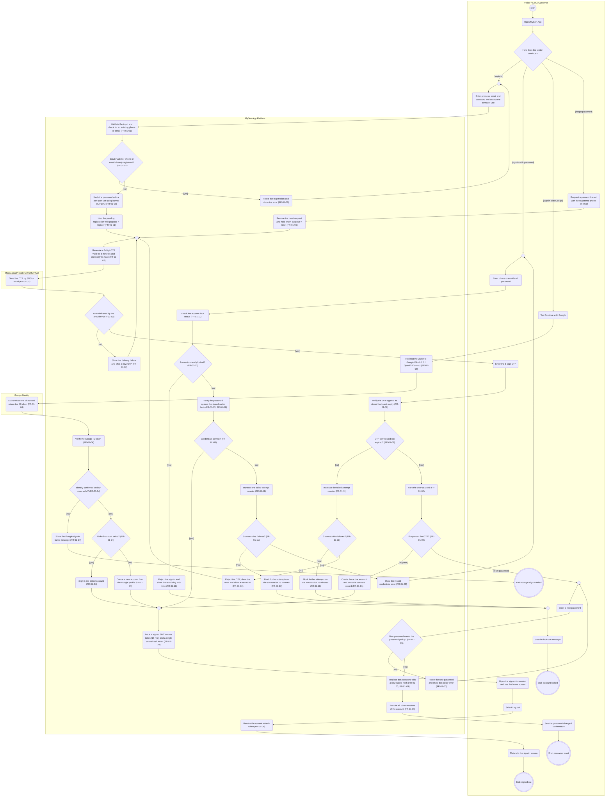

# AD-UC-01 — Register / Log in (Đăng ký / Đăng nhập)

| Thuộc tính | Giá trị |
|---|---|
| Use case | UC-01 — Register / Log in (Đăng ký / Đăng nhập) |
| Feature | F-01 Identity & User Management |
| Người phụ trách | Lê Thành Hiệp (MSSV 2411560014) |
| FR trong phạm vi | FR-01-01 → FR-01-06, FR-01-09, FR-01-10, FR-01-11 (FR-01-07 và FR-01-08: xem Mục 4.3) |
| Nguồn dữ liệu | `Group_F_Function_List___Cost_DBIZ2.xlsx` — sheets *Scope*, *FunctionList*, *Prioritization* (Initial & Effective priority) |
| Sequence trong Excel | S-01 (đăng ký + OTP), S-02 (đăng nhập, đăng xuất), S-03 (Google SSO), S-04 (quên mật khẩu) |
| Trạng thái | Bước 1–5 hoàn tất bản nháp · Peer Review: chờ nhóm bạn (xem Mục 7) |

---

## Mục 1 — Sơ đồ Activity (Bước 1 & 2)

### 1.1 Làn sử dụng (Bước 1)

| Làn (đúng tên chuẩn) | Loại làn | Vai trò trong UC | Số nút |
|---|---|---|---|
| Visitor / GenZ Customer | Tác nhân | Visitor chọn luồng, nhập thông tin/OTP, xem kết quả | 22 |
| MySen App Platform | Hệ thống của bạn | Xác thực, băm mật khẩu, cấp/kiểm OTP, khóa tài khoản, cấp JWT | 42 |
| Google Identity | Hệ thống bên ngoài | Xác thực danh tính Google và trả ID token (FR-01-04) | 1 |
| Messaging Providers (FCM/APNs) | Hệ thống bên ngoài | Cổng SMS/email gửi OTP (FR-01-02) — xem A-01 | 1 |

Không dùng: Partner, Staff & Admin, Indie Artists, Marketing & Sales Dept, IT & Technical Dept, Payment Gateway, GPS Service, F&B Partner POS (không tham gia UC-01). Không có làn kỹ thuật (Backend/Frontend/Database/Web App).

### 1.2 Mã Mermaid (Bước 2)



**Chú giải ký hiệu:** `st((…))` = Start · `en(((…)))` = End · `s1("…")` = hành động · `d1{"…"}` = quyết định (mỗi cạnh ra có guard) ·
`m1{" "}` = merge (nút hợp nhất, đích của mọi vòng lặp lùi). Mỗi `subgraph` là một làn. Mermaid không có swimlane thật nên khung làn có thể chồng lên nhau khi render — đây là hạn chế hiển thị, không phải lỗi cú pháp.

---

## Mục 2 — Node Trace Table (Bước 3)

### 2.1 Bảng vết: nút → FR (Excel, sheet *FunctionList*)

| Node ID | Làn | Loại | Nhãn trên sơ đồ | FR ID | Tên FR (sheet FunctionList) | L3 liên quan | Priority (Initial → Effective) | Ghi chú |
|---|---|---|---|---|---|---|---|---|
| st | Visitor / GenZ Customer | Start | Start | — | — | — | — | Nút điều khiển – điểm bắt đầu, không phải hành động |
| v1 | Visitor / GenZ Customer | Action | Open MySen App | FR-01-01 | Register an account and verify it with OTP | FR-01-01-FE | Must | Điểm vào của UC-01 |
| d1 | Visitor / GenZ Customer | Decision | How does the visitor continue? | FR-01-01<br>FR-01-03<br>FR-01-04<br>FR-01-05 | Register an account and verify it with OTP<br>Sign in with password<br>Sign in with Google (SSO)<br>Reset a forgotten password | — | Must<br>Must<br>Should<br>Must | Quyết định của tác nhân → chọn 1 trong 4 luồng; không phải hành động hệ thống |
| m1 | Visitor / GenZ Customer | Merge | (trống) | — | — | — | — | Nút điều khiển – hợp nhất luồng / đích của vòng lặp lùi |
| v2 | Visitor / GenZ Customer | Action | Enter phone or email and password and accept the terms of use | FR-01-01 | Register an account and verify it with OTP | FR-01-01-FE | Must | Hành động của tác nhân – ánh xạ tới FR mà nó kích hoạt |
| v3 | Visitor / GenZ Customer | Action | Enter the 6-digit OTP | FR-01-01 | Register an account and verify it with OTP | FR-01-01-FE | Must | Màn hình OTP có đếm ngược gửi lại |
| v4 | Visitor / GenZ Customer | Action | Request a password reset with the registered phone or email | FR-01-05 | Reset a forgotten password | FR-01-05-FE | Must | Hành động của tác nhân – ánh xạ tới FR mà nó kích hoạt |
| m6 | Visitor / GenZ Customer | Merge | (trống) | — | — | — | — | Nút điều khiển – hợp nhất luồng / đích của vòng lặp lùi |
| v5 | Visitor / GenZ Customer | Action | Enter a new password | FR-01-05 | Reset a forgotten password | FR-01-05-FE | Must | Hành động của tác nhân – ánh xạ tới FR mà nó kích hoạt |
| m4 | Visitor / GenZ Customer | Merge | (trống) | — | — | — | — | Nút điều khiển – hợp nhất luồng / đích của vòng lặp lùi |
| v6 | Visitor / GenZ Customer | Action | Enter phone or email and password | FR-01-03 | Sign in with password | FR-01-03-FE | Must | Hành động của tác nhân – ánh xạ tới FR mà nó kích hoạt |
| v7 | Visitor / GenZ Customer | Action | Tap Continue with Google | FR-01-04 | Sign in with Google (SSO) | FR-01-04-FE | Should | Hành động của tác nhân – ánh xạ tới FR mà nó kích hoạt |
| m5 | Visitor / GenZ Customer | Merge | (trống) | — | — | — | — | Nút điều khiển – hợp nhất luồng / đích của vòng lặp lùi |
| v8 | Visitor / GenZ Customer | Action | See the lock-out message | FR-01-11 | Lock sign-in after repeated failed attempts | FR-01-03-FE | Must | FR-01-03-FE có "error and lock-out messages" |
| v9 | Visitor / GenZ Customer | Action | Open the signed-in session and see the home screen | FR-01-03<br>FR-01-10 | Sign in with password<br>Manage sessions with JWT access and refresh tokens | FR-01-03-FE<br>FR-01-10-FE | Must<br>Must | FE giữ token trong secure storage (FR-01-10-FE) |
| v10 | Visitor / GenZ Customer | Action | Select Log out | FR-01-06 | Sign out | FR-01-06-FE | Must | Hành động của tác nhân – ánh xạ tới FR mà nó kích hoạt |
| v11 | Visitor / GenZ Customer | Action | Return to the sign-in screen | FR-01-06 | Sign out | FR-01-06-FE | Must | Hành động của tác nhân – ánh xạ tới FR mà nó kích hoạt |
| v12 | Visitor / GenZ Customer | Action | See the password-changed confirmation | FR-01-05 | Reset a forgotten password | FR-01-05-FE | Must | Hành động của tác nhân – ánh xạ tới FR mà nó kích hoạt |
| en1 | Visitor / GenZ Customer | End | End: account locked | — | — | — | — | Nút điều khiển – điểm kết thúc, không phải hành động |
| en2 | Visitor / GenZ Customer | End | End: password reset | — | — | — | — | Nút điều khiển – điểm kết thúc, không phải hành động |
| en3 | Visitor / GenZ Customer | End | End: signed out | — | — | — | — | Nút điều khiển – điểm kết thúc, không phải hành động |
| en4 | Visitor / GenZ Customer | End | End: Google sign-in failed | — | — | — | — | Nút điều khiển – điểm kết thúc, không phải hành động |
| s1 | MySen App Platform | Action | Validate the input and check for an existing phone or email (FR-01-01) | FR-01-01 | Register an account and verify it with OTP | FR-01-01-BE | Must |  |
| d2 | MySen App Platform | Decision | Input invalid or phone or email already registered? (FR-01-01) | FR-01-01 | Register an account and verify it with OTP | FR-01-01-BE | Must |  |
| s2 | MySen App Platform | Action | Reject the registration and show the error (FR-01-01) | FR-01-01 | Register an account and verify it with OTP | FR-01-01-BE | Must |  |
| s3 | MySen App Platform | Action | Hash the password with a per-user salt using bcrypt or Argon2 (FR-01-09) | FR-01-09 | Store passwords as salted hashes | FR-01-09-BE | Must |  |
| s4 | MySen App Platform | Action | Hold the pending registration with purpose = register (FR-01-01) | FR-01-01 | Register an account and verify it with OTP | FR-01-01-BE | Must |  |
| s5 | MySen App Platform | Action | Receive the reset request and hold it with purpose = reset (FR-01-05) | FR-01-05 | Reset a forgotten password | FR-01-05-BE | Must |  |
| m2 | MySen App Platform | Merge | (trống) | — | — | — | — | Nút điều khiển – hợp nhất luồng / đích của vòng lặp lùi |
| s6 | MySen App Platform | Action | Generate a 6-digit OTP valid for 5 minutes and store only its hash (FR-01-02) | FR-01-02 | Issue and deliver a one-time password (OTP) | FR-01-02-BE | Must |  |
| d3 | MySen App Platform | Decision | OTP delivered by the provider? (FR-01-02) | FR-01-02 | Issue and deliver a one-time password (OTP) | FR-01-02-INT | Must | Delivery-failure handling nằm trong FR-01-02-INT |
| s7 | MySen App Platform | Action | Show the delivery failure and offer a new OTP (FR-01-02) | FR-01-02 | Issue and deliver a one-time password (OTP) | FR-01-02-INT | Must |  |
| s8 | MySen App Platform | Action | Verify the OTP against its stored hash and expiry (FR-01-02) | FR-01-02 | Issue and deliver a one-time password (OTP) | FR-01-02-BE | Must |  |
| d4 | MySen App Platform | Decision | OTP correct and not expired? (FR-01-02) | FR-01-02 | Issue and deliver a one-time password (OTP) | FR-01-02-BE | Must |  |
| s9 | MySen App Platform | Action | Increase the failed-attempt counter (FR-01-11) | FR-01-11 | Lock sign-in after repeated failed attempts | FR-01-11-BE | Must |  |
| d5 | MySen App Platform | Decision | 5 consecutive failures? (FR-01-11) | FR-01-11 | Lock sign-in after repeated failed attempts | FR-01-11-BE | Must |  |
| s10 | MySen App Platform | Action | Block further attempts on the account for 15 minutes (FR-01-11) | FR-01-11 | Lock sign-in after repeated failed attempts | FR-01-11-BE | Must |  |
| s11 | MySen App Platform | Action | Reject the OTP, show the error and allow a new OTP (FR-01-02) | FR-01-02 | Issue and deliver a one-time password (OTP) | FR-01-02-BE<br>FR-01-01-FE | Must |  |
| s12 | MySen App Platform | Action | Mark the OTP as used (FR-01-02) | FR-01-02 | Issue and deliver a one-time password (OTP) | FR-01-02-BE | Must |  |
| d6 | MySen App Platform | Decision | Purpose of the OTP? (FR-01-02) | FR-01-02 | Issue and deliver a one-time password (OTP) | FR-01-02-BE | Must | Mục đích được ghi ở s4 hoặc s5 |
| s13 | MySen App Platform | Action | Create the active account and store the consent record (FR-01-01) | FR-01-01 | Register an account and verify it with OTP | FR-01-01-BE | Must |  |
| d7 | MySen App Platform | Decision | New password meets the password policy? (FR-01-05) | FR-01-05 | Reset a forgotten password | FR-01-05-BE | Must |  |
| s16 | MySen App Platform | Action | Reject the new password and show the policy error (FR-01-05) | FR-01-05 | Reset a forgotten password | FR-01-05-BE | Must |  |
| s14 | MySen App Platform | Action | Replace the password with a new salted hash (FR-01-05, FR-01-09) | FR-01-05<br>FR-01-09 | Reset a forgotten password<br>Store passwords as salted hashes | FR-01-05-BE<br>FR-01-09-BE | Must<br>Must |  |
| s15 | MySen App Platform | Action | Revoke all other sessions of the account (FR-01-05) | FR-01-05 | Reset a forgotten password | FR-01-05-BE | Must |  |
| s17 | MySen App Platform | Action | Check the account lock status (FR-01-11) | FR-01-11 | Lock sign-in after repeated failed attempts | FR-01-11-BE | Must |  |
| d8 | MySen App Platform | Decision | Account currently locked? (FR-01-11) | FR-01-11 | Lock sign-in after repeated failed attempts | FR-01-11-BE | Must |  |
| s18 | MySen App Platform | Action | Reject the sign-in and show the remaining lock time (FR-01-11) | FR-01-11 | Lock sign-in after repeated failed attempts | FR-01-11-BE | Must |  |
| s19 | MySen App Platform | Action | Verify the password against the stored salted hash (FR-01-03, FR-01-09) | FR-01-03<br>FR-01-09 | Sign in with password<br>Store passwords as salted hashes | FR-01-03-BE<br>FR-01-09-BE | Must<br>Must |  |
| d9 | MySen App Platform | Decision | Credentials correct? (FR-01-03) | FR-01-03 | Sign in with password | FR-01-03-BE | Must |  |
| s20 | MySen App Platform | Action | Increase the failed-attempt counter (FR-01-11) | FR-01-11 | Lock sign-in after repeated failed attempts | FR-01-11-BE | Must |  |
| d10 | MySen App Platform | Decision | 5 consecutive failures? (FR-01-11) | FR-01-11 | Lock sign-in after repeated failed attempts | FR-01-11-BE | Must |  |
| s21 | MySen App Platform | Action | Block further attempts on the account for 15 minutes (FR-01-11) | FR-01-11 | Lock sign-in after repeated failed attempts | FR-01-11-BE | Must |  |
| s22 | MySen App Platform | Action | Show the invalid-credentials error (FR-01-03) | FR-01-03 | Sign in with password | FR-01-03-FE | Must |  |
| s23 | MySen App Platform | Action | Redirect the visitor to Google OAuth 2.0 / OpenID Connect (FR-01-04) | FR-01-04 | Sign in with Google (SSO) | FR-01-04-INT<br>FR-01-04-FE | Should |  |
| s24 | MySen App Platform | Action | Verify the Google ID token (FR-01-04) | FR-01-04 | Sign in with Google (SSO) | FR-01-04-BE | Should |  |
| d11 | MySen App Platform | Decision | Identity confirmed and ID token valid? (FR-01-04) | FR-01-04 | Sign in with Google (SSO) | FR-01-04-BE | Should |  |
| d12 | MySen App Platform | Decision | Linked account exists? (FR-01-04) | FR-01-04 | Sign in with Google (SSO) | FR-01-04-BE | Should |  |
| s25 | MySen App Platform | Action | Sign in the linked account (FR-01-04) | FR-01-04 | Sign in with Google (SSO) | FR-01-04-BE | Should |  |
| s26 | MySen App Platform | Action | Create a new account from the Google profile (FR-01-04) | FR-01-04 | Sign in with Google (SSO) | FR-01-04-BE | Should |  |
| s27 | MySen App Platform | Action | Show the Google sign-in failed message (FR-01-04) | FR-01-04 | Sign in with Google (SSO) | FR-01-04-FE | Should |  |
| m3 | MySen App Platform | Merge | (trống) | — | — | — | — | Nút điều khiển – hợp nhất luồng / đích của vòng lặp lùi |
| s28 | MySen App Platform | Action | Issue a signed JWT access token (15 min) and a single-use refresh token (FR-01-10) | FR-01-10 | Manage sessions with JWT access and refresh tokens | FR-01-10-BE | Must |  |
| s29 | MySen App Platform | Action | Revoke the current refresh token (FR-01-06) | FR-01-06 | Sign out | FR-01-06-BE | Must |  |
| g1 | Google Identity | Action | Authenticate the visitor and return the ID token (FR-01-04) | FR-01-04 | Sign in with Google (SSO) | FR-01-04-INT | Should |  |
| p1 | Messaging Providers (FCM/APNs) | Action | Send the OTP by SMS or email (FR-01-02) | FR-01-02 | Issue and deliver a one-time password (OTP) | FR-01-02-INT | Must | Cổng SMS / email provider (xem Mục 4, A-01) |

### 2.2 Ma trận phủ FR

| FR ID | Tên FR | Priority | Nút hệ thống / bên ngoài (có FR trong nhãn) | Nút tác nhân liên quan | Ghi chú |
|---|---|---|---|---|---|
| FR-01-01 | Register an account and verify it with OTP | Must | s1, d2, s2, s4, s13 | v1, d1, v2, v3 |  |
| FR-01-02 | Issue and deliver a one-time password (OTP) | Must | s6, d3, s7, s8, d4, s11, s12, d6, p1 | — |  |
| FR-01-03 | Sign in with password | Must | s19, d9, s22 | d1, v6, v9 |  |
| FR-01-04 | Sign in with Google (SSO) | Should | s23, s24, d11, d12, s25, s26, s27, g1 | d1, v7 |  |
| FR-01-05 | Reset a forgotten password | Must | s5, d7, s16, s14, s15 | d1, v4, v5, v12 |  |
| FR-01-06 | Sign out | Must | s29 | v10, v11 |  |
| FR-01-07 | View and edit profile | Must | — | — | KHÔNG VẼ — xem Mục 4.3 (luồng tuyến tính, không có nhánh nghiệp vụ) |
| FR-01-08 | Enforce basic role-based access control | Must | — | — | Vẽ ở AD-UC-10 (nút s1, d2, s2): kiểm tra vai trò trên mọi API là hành động xuyên suốt, không thuộc luồng đăng nhập |
| FR-01-09 | Store passwords as salted hashes | Must | s3, s14, s19 | — |  |
| FR-01-10 | Manage sessions with JWT access and refresh tokens | Must | s28 | v9 |  |
| FR-01-11 | Lock sign-in after repeated failed attempts | Must | s9, d5, s10, s17, d8, s18, s20, d10, s21 | v8 |  |

---

## Mục 3 — Branch Tests (Bước 4)

| Test ID | Nút | Guard | Luồng đi qua | Given | When | Then | FR |
|---|---|---|---|---|---|---|---|
| BT-01-01 | d1 | [register] | d1→m1→v2 | Visitor chưa có tài khoản đang ở màn hình chào của MySen App | bấm "Đăng ký" | App mở form đăng ký (SĐT/email, mật khẩu, đồng ý điều khoản) | FR-01-01 |
| BT-01-02 | d1 | [sign in with password] | d1→m4→v6 | Visitor đã có tài khoản active với SĐT 0912345678 | bấm "Đăng nhập bằng mật khẩu" | App mở form đăng nhập (SĐT/email + mật khẩu) | FR-01-03 |
| BT-01-03 | d1 | [sign in with Google] | d1→v7→s23 | Visitor dùng điện thoại đã đăng nhập tài khoản Google | bấm "Continue with Google" | App chuyển hướng sang Google OAuth 2.0 / OpenID Connect | FR-01-04 |
| BT-01-04 | d1 | [forgot password] | d1→v4→s5→m2 | Visitor quên mật khẩu, nhớ email linh.nguyen@gmail.com | bấm "Quên mật khẩu" và gửi email đó | Hệ thống ghi nhận yêu cầu reset (purpose = reset) rồi đi vào bước tạo OTP | FR-01-05 |
| BT-01-05 | d2 | [yes] | d2→s2→m1→v2 | SĐT 0912345678 đã có tài khoản active | Visitor gửi form với SĐT đó, mật khẩu Mysen@2026 và đã tick đồng ý điều khoản (hoặc nhập email sai định dạng "linh.nguyen@") | Hệ thống từ chối, báo "Số điện thoại đã được đăng ký", KHÔNG tạo OTP, form được giữ lại để sửa | FR-01-01 |
| BT-01-06 | d2 | [no] | d2→s3→s4→m2 | SĐT 0987654321 chưa tồn tại trong hệ thống | Visitor gửi form hợp lệ với mật khẩu Mysen@2026 và đã đồng ý điều khoản | Mật khẩu được băm bằng bcrypt/Argon2 với salt riêng, bản đăng ký được giữ ở trạng thái chờ, hệ thống chuyển sang tạo OTP | FR-01-01, FR-01-09 |
| BT-01-07 | d3 | [yes] | d3→v3 | Cổng SMS hoạt động bình thường | hệ thống gửi OTP 6 số tới 0987654321 | Cổng trả "accepted", màn hình nhập OTP hiện với đồng hồ đếm ngược gửi lại | FR-01-02 |
| BT-01-08 | d3 | [no] | d3→s7→m2 | Cổng SMS trả lỗi timeout (HTTP 504) | hệ thống gửi OTP tới 0987654321 | App báo "Chưa gửi được mã, vui lòng thử lại"; bấm thử lại sẽ quay về m2 và tạo OTP mới; chưa có tài khoản nào được tạo | FR-01-02 |
| BT-01-09 | d4 | [yes] | d4→s12→d6 | OTP 482913 được gửi lúc 10:00:00 (hiệu lực đến 10:05:00) | Visitor nhập 482913 lúc 10:03:20 | OTP hợp lệ, được đánh dấu đã dùng; hệ thống xét mục đích OTP | FR-01-02 |
| BT-01-10 | d4 | [no] | d4→s9→d5 | OTP 482913 gửi lúc 10:00:00 | Visitor nhập 111111 (sai), hoặc nhập đúng 482913 lúc 10:06:00 (đã quá 5 phút) | OTP bị từ chối và bộ đếm thất bại tăng thêm 1 | FR-01-02, FR-01-11 |
| BT-01-11 | d5 | [yes] | d5→s10→m5→v8→en1 | Cùng SĐT 0987654321 đã nhập sai OTP 4 lần liên tiếp | Visitor nhập sai lần thứ 5 lúc 10:04:00 | Hệ thống chặn mọi lần thử mới đến 10:19:00 và hiển thị thông báo khóa | FR-01-11 |
| BT-01-12 | d5 | [no] | d5→s11→m2 | Đây là lần nhập sai OTP đầu tiên | Visitor nhập 111111 | App báo "Mã OTP không đúng", hệ thống tạo OTP mới (OTP cũ không dùng được nữa) và cho nhập lại | FR-01-02, FR-01-11 |
| BT-01-13 | d6 | [register] | d6→s13→m3 | OTP đúng và bản chờ có purpose = register | hệ thống xét mục đích OTP | Tạo tài khoản active cho 0987654321 kèm bản ghi đồng ý điều khoản, rồi cấp token | FR-01-01 |
| BT-01-14 | d6 | [reset password] | d6→m6→v5 | OTP đúng và yêu cầu có purpose = reset | hệ thống xét mục đích OTP | App mở màn hình đặt mật khẩu mới; tài khoản chưa bị đổi gì cho đến khi mật khẩu mới hợp lệ | FR-01-05 |
| BT-01-15 | d7 | [yes] | d7→s14→s15→v12→en2 | OTP reset đã đúng, tài khoản linh.nguyen@gmail.com đang đăng nhập trên 2 thiết bị khác | Visitor nhập mật khẩu mới Mysen#2027 (đạt chính sách) | Mật khẩu được thay bằng salted hash mới, cả 2 phiên trên thiết bị khác bị thu hồi, app hiển thị xác nhận | FR-01-05, FR-01-09 |
| BT-01-16 | d7 | [no] | d7→s16→m6→v5 | OTP reset đã đúng | Visitor nhập mật khẩu mới "123" (không đạt chính sách) | Báo lỗi chính sách mật khẩu, mật khẩu cũ giữ nguyên, quay lại ô nhập mật khẩu mới | FR-01-05 |
| BT-01-17 | d8 | [yes] | d8→s18→m5→v8→en1 | Tài khoản 0912345678 bị khóa lúc 09:00, bây giờ là 09:05 | Visitor nhập ĐÚNG mật khẩu Mysen@2026 | Bị từ chối ngay, không so sánh mật khẩu, hiển thị còn khoảng 10 phút | FR-01-11 |
| BT-01-18 | d8 | [no] | d8→s19 | Tài khoản 0912345678 không bị khóa | Visitor gửi SĐT và mật khẩu | Hệ thống chuyển sang đối chiếu mật khẩu với salted hash | FR-01-11, FR-01-03 |
| BT-01-19 | d9 | [yes] | d9→m3→s28→v9 | Tài khoản active 0912345678, mật khẩu đã lưu là Mysen@2026 | Visitor nhập đúng SĐT và mật khẩu | Cấp JWT access token 15 phút + refresh token dùng một lần, mở phiên và hiển thị màn hình Home | FR-01-03, FR-01-10 |
| BT-01-20 | d9 | [no] | d9→s20→d10 | Tài khoản 0912345678 chưa bị khóa | Visitor nhập mật khẩu sai "Mysen@2025" | Không cấp phiên, bộ đếm thất bại tăng 1 | FR-01-03, FR-01-11 |
| BT-01-21 | d10 | [yes] | d10→s21→m5→v8→en1 | Tài khoản 0912345678 đã sai mật khẩu 4 lần liên tiếp | Visitor sai lần thứ 5 | Tài khoản bị chặn thử thêm trong 15 phút và app hiển thị thông báo khóa | FR-01-11 |
| BT-01-22 | d10 | [no] | d10→s22→m4→v6 | Tài khoản 0912345678 mới sai mật khẩu lần thứ 2 | Visitor sai thêm một lần nữa (lần 3) | App báo "Sai thông tin đăng nhập" (thông báo chung), giữ form và cho nhập lại | FR-01-03 |
| BT-01-23 | d11 | [yes] | d11→d12 | Google xác nhận danh tính; ID token đúng client ID và chưa hết hạn | backend xác thực ID token | Token được chấp nhận, hệ thống đi tiếp tới bước tìm tài khoản liên kết | FR-01-04 |
| BT-01-24 | d11 | [no] | d11→s27→en4 | Visitor bấm Hủy trên màn hình Google, hoặc ID token đã hết hạn | backend nhận kết quả từ Google | App báo "Đăng nhập Google không thành công", không tạo phiên và không tạo tài khoản | FR-01-04 |
| BT-01-25 | d12 | [yes] | d12→s25→m3 | Email linh.nguyen@gmail.com đã liên kết với một tài khoản MySen | Google xác nhận danh tính email đó | Đăng nhập vào đúng tài khoản cũ, không tạo tài khoản mới, rồi cấp token | FR-01-04 |
| BT-01-26 | d12 | [no] | d12→s26→m3 | Email an.tran@gmail.com chưa có tài khoản MySen | Google xác nhận danh tính email đó | Tạo tài khoản mới từ hồ sơ Google rồi cấp token. Rủi ro đã chấp nhận: nếu cùng email đã đăng ký bằng mật khẩu thì có thể bị trùng (Scope bảng 3) | FR-01-04 |

**Kiểm thử bổ sung cho nút đặc biệt (không phải nhánh rẽ):**

| Test ID | Nút | Guard | Luồng đi qua | Given | When | Then | FR |
|---|---|---|---|---|---|---|---|
| NT-01-01 | s3 | Kiểm tra nút | s3 | Hai tài khoản A và B cùng đặt mật khẩu Mysen@2026 | xem bản ghi mật khẩu trong DB | Hai chuỗi hash khác nhau (salt riêng), không có mật khẩu rõ trong DB, log hay response | FR-01-09 |
| NT-01-02 | s6 | Kiểm tra nút | s6 | Vừa tạo OTP 482913 cho 0987654321 | xem bản ghi OTP trong DB | Chỉ có hash của OTP kèm thời hạn 5 phút, không lưu 482913 dạng rõ | FR-01-02 |

---

## Mục 4 — Giả định & phạm vi

### 4.1 Giả định

| ID | Giả định | Lý do |
|---|---|---|
| A-01 | Cổng SMS/email gửi OTP được vẽ ở làn **Messaging Providers (FCM/APNs)** | Quy tắc làn chỉ cho phép tên này; FR-01-02-INT nêu "SMS gateway and email provider" |
| A-02 | "Gửi lại OTP" = quay về m2 và tạo OTP mới; OTP cũ bị vô hiệu | FR-01-01-FE có "resend countdown" nhưng Excel không mô tả OTP cũ |
| A-03 | Một bộ đếm thất bại dùng chung cho OTP và mật khẩu; vẽ hai cặp nút (s9/d5 và s20/d10) vì ngữ cảnh khác nhau | FR-01-11: "5 consecutive sign-in or OTP attempts" |
| A-04 | Khi đăng ký chưa có tài khoản, khóa áp dụng cho SĐT/email đang chờ | FR-01-11 chỉ nói "account" |
| A-05 | Lỗi gửi OTP (d3 [no]) không tính vào bộ đếm thất bại | Không phải lỗi của người dùng |
| A-06 | Sau khi đặt lại mật khẩu, Visitor phải đăng nhập lại (không tự đăng nhập) | FR-01-05 chỉ nói "replace the password and sign out all other sessions" |
| A-07 | d11 gộp "Google từ chối/Visitor hủy" và "ID token không hợp lệ" vào một nhánh [no] | Cùng kết quả cho người dùng; kiểm thử đã tách các tình huống |
| A-08 | Sign-out (FR-01-06) vẽ như phần đuôi của luồng sau khi vào Home | FR-01-06 thuộc UC-01 nhưng không có nhánh rẽ riêng |

### 4.2 Ngoài phạm vi (Won't-have, từ sheet *Scope* bảng 3) — không vẽ

Đăng nhập Apple ID / Facebook / OTP không mật khẩu · chống trùng tài khoản giữa các phương thức đăng nhập · đổi mật khẩu/SĐT/email, danh sách thiết bị, cảnh báo thiết bị mới · cài đặt riêng tư/đồng ý, tự xóa tài khoản · mã hóa dữ liệu cá nhân và nhật ký đăng nhập.

### 4.3 FR của F-01 không có trong sơ đồ này

- **FR-01-07 (View and edit profile):** luồng tuyến tính "mở hồ sơ → sửa tên/ngày sinh → lưu → hiển thị", chỉ có kiểm tra dữ liệu hợp lệ; không có quyết định nghiệp vụ nào đáng vẽ. **Nếu giảng viên yêu cầu phủ 100% FR của UC-01, cần thêm một nhánh riêng — hãy xác nhận.**
- **FR-01-08 (RBAC):** vẽ ở AD-UC-10 vì là kiểm tra trên mọi API, không thuộc luồng đăng ký/đăng nhập.

---

## Mục 5 — Tự kiểm tra tự động (trước khi rà soát AI)

Kiểm tra chạy trên chính đoạn mã Mermaid ở Mục 1.2 (66 nút, 76 cạnh):

| # | Tiêu chí | Kết quả |
|---|---|---|
| L1 | Chỉ dùng làn được phép (không có Backend/Frontend/Database/Web App) | ✅ Đạt |
| L2 | Mọi hành động/quyết định của hệ thống kết thúc bằng (FR-xx-xx) | ✅ Đạt |
| L3 | Mọi mã FR tồn tại trong sheet FunctionList của Excel | ✅ Đạt |
| L4 | Mọi nút rẽ nhánh có ≥2 nhánh và mỗi nhánh có guard không rỗng và khác nhau ([yes]/[no] hoặc nhãn riêng) | ✅ Đạt |
| L5 | Chỉ nút rẽ nhánh mới có guard trên cạnh đi ra | ✅ Đạt |
| L6 | Mọi vòng lặp lùi về đều đi qua nút merge (tìm thấy 5 cạnh lùi) | ✅ Đạt |
| L7 | Mọi nút đều đi tới được từ một Start | ✅ Đạt |
| L8 | Start không có cạnh vào; End không có cạnh ra; mọi nút khác đều có lối ra | ✅ Đạt |
| L9 | Mỗi merge có ≥2 cạnh vào và đúng 1 cạnh ra | ✅ Đạt |
| L10 | Nhãn không chứa ký tự dễ làm hỏng Mermaid (" # ; < > `) | ✅ Đạt |
| L11 | Số nút = 66, số cạnh = 76, nút rẽ nhánh = 12, merge = 6 | ✅ Đạt |
| L12 | Mermaid parser (mermaid@11.4.1, flowchart) phân tích không lỗi | ✅ Đạt |

Ghi chú: nút `d1` và `d6` dùng guard có tên (`[register]`, `[reset password]`…) thay vì `[yes]/[no]` vì câu hỏi có nhiều lựa chọn; vẫn thỏa yêu cầu "guard rõ ràng".

---

## Mục 6 — Rà soát AI (Bước 5)

### 6.1 Prompt Critic đã dùng

```text
Bạn là reviewer khó tính về UML Activity Diagram và phân tích nghiệp vụ.
Tôi gửi kèm: (1) mã Mermaid flowchart TD của UC-01 (Register / Log in); (2) các dòng FR liên quan trong
Excel (FR-01-01…FR-01-06, FR-01-09…FR-01-11) gồm tên FR và tiêu chí EARS; (3) bảng Node Trace và Branch Tests.

Quy tắc bắt buộc của sơ đồ:
- Chỉ dùng các làn: Visitor / GenZ Customer, Marketing & Sales Dept, IT & Technical Dept,
  MySen App Platform, Google Identity, Messaging Providers (FCM/APNs). KHÔNG có làn Backend/Frontend/Database/Web App.
- Mọi hành động của hệ thống kết thúc bằng mã FR trong ngoặc, ví dụ s1("Anti-cheat Validation (FR-04-02)").
- Mọi nút rẽ nhánh phải có guard rõ ràng trên từng cạnh đi ra, ví dụ |"[yes]"| và |"[no]"|.
- Mọi vòng lặp lùi về phải đi qua nút merge, ví dụ m1{" "}.

Hãy làm 3 việc, KHÔNG viết lại sơ đồ trừ khi tôi yêu cầu:
A. Lỗi cú pháp Mermaid và vi phạm 4 quy tắc trên (nêu node ID cụ thể).
B. Lỗ hổng nghiệp vụ: nhánh thiếu, trạng thái không kết thúc, vòng lặp vô hạn, deadlock, nhánh lỗi bị bỏ sót,
   lỗ hổng bảo mật, chỗ sơ đồ mâu thuẫn với tiêu chí EARS trong Excel.
C. Chỗ nào bạn phải ĐOÁN vì Excel không nói rõ — hãy liệt kê thành câu hỏi, đừng tự bịa quy tắc.
Xuất kết quả dạng bảng: # | Loại (A/B/C) | Node ID | Mô tả | Mức (Cao/TB/Thấp) | Đề xuất sửa.
```

### 6.2 Kết quả rà soát

> **Lưu ý trung thực:** lượt rà soát này do chính Claude (cùng AI đã viết sơ đồ) thực hiện nên có thể cùng "điểm mù".
> Hãy dán prompt trên cho một AI khác (hoặc model khác) và ghi thêm các dòng C-xx mới vào bảng dưới trước khi nộp.

| # | Loại | Vị trí | Phát hiện | Mức | Trạng thái |
|---|---|---|---|---|---|
| C-01 | B | Google: s24→d11→…→m3 | Luồng Google không kiểm tra khóa tài khoản (d8 chỉ nằm ở luồng mật khẩu), nên tài khoản đang bị khóa 15 phút vẫn vào được qua Google. FR-01-11 nói chung chung về "sign-in attempts". | TB | Mở — cần chốt với khách hàng; chưa thêm vào sơ đồ vì Excel không quy định |
| C-02 | B | s10 / FR-01-11 | FR-01-11 khóa theo "account" nhưng lúc đăng ký tài khoản chưa tồn tại. | TB | Giả định A-04: khóa theo SĐT/email đang chờ |
| C-03 | B | m2 loop (s7, s11) | Excel không nói OTP cũ có bị vô hiệu khi gửi OTP mới hay không. | TB | Giả định A-02: OTP cũ bị vô hiệu |
| C-04 | C | d7, d2 | "valid password" trong FR-01-01/05 không có quy tắc cụ thể (độ dài, ký tự). | TB | Mở — nhóm cần chốt chính sách mật khẩu |
| C-05 | B | d12 [no] / s26 | Có thể tạo tài khoản trùng khi cùng email đã đăng ký bằng mật khẩu (điểm và vé bị tách đôi). | Cao (hậu quả) — đã được chấp nhận | Ghi nhận — Scope bảng 3 "Duplicate-account protection" hoãn sang release 2 |
| C-06 | B | d2 [yes] | Thông báo "đã đăng ký" làm lộ việc một SĐT/email có tài khoản (dò tài khoản). | Thấp | Chấp nhận — FR-01-01 bắt buộc "reject duplicate"; luồng quên mật khẩu dùng thông báo chung |
| C-07 | A | p1 / lane LP | Tên làn "Messaging Providers (FCM/APNs)" là push, nhưng OTP đi qua SMS/email (FR-01-02-INT). | Thấp | Giả định A-01: dùng đúng tên làn chuẩn, ghi rõ trong nhãn p1 |
| C-08 | A | Toàn bộ sơ đồ | Lint tự động L1–L12 đạt; render Chromium thành công (66 nút, 76 cạnh). Sơ đồ khá dày. | Thấp | Đã xác minh; có thể tách thành 2 sơ đồ (đăng ký/đăng nhập) nếu giảng viên yêu cầu |

---

## Mục 7 — Peer Review (Bước 5)

Nhóm phản biện: **Team__ (chưa gán)** · Ngày giao: __/__/2026 · Ngày nhận lại: __/__/2026

| Hạng mục | Trạng thái |
|---|---|
| Đã chuyển thư mục cho nhóm bạn | ☐ |
| Nhận lại tệp `review-TeamXX.md` | ☐ |
| Đã xử lý từng nhận xét (ghi Accept / Reject + lý do vào cuối tệp review) | ☐ |

Mẫu tệp nhận xét: xem `review-TeamXX.template.md`.
