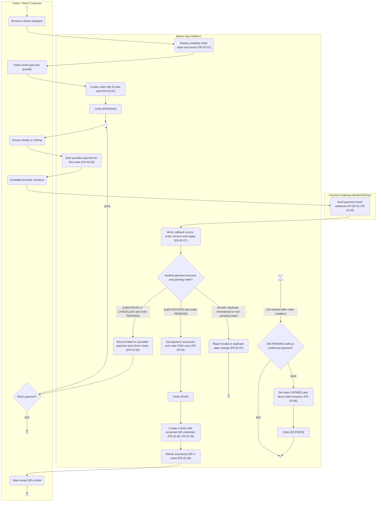

# Activity Diagram: AD-UC-02A Purchase online e-tickets and pay

> **DBIZ2 · Lesson 7 · MySen App Platform**  
> **Use Case split proposal:** `UC-02A` is proposed from W0's existing `UC-02 Purchase E-Tickets & Pay`. ID not yet approved in W0. This diagram covers purchase/payment only, not later refund or loyalty redemption.

| Field | Value |
|---|---|
| AD ID | `AD-UC-02A` (proposed) |
| Use case | `UC-02A` Purchase online e-tickets and pay |
| Feature | `F-02` E-Ticketing & Commerce |
| Primary actor | Visitor / GenZ Customer; supporting external actor: Payment Gateway (MoMo/VNPay) |
| Lanes | Visitor / GenZ Customer · MySen App Platform · Payment Gateway (MoMo/VNPay) |
| Inputs (L3-L5) | MySen W0 Table 1 (`UC-02`, original) · W0 Table 2 (`F-02`) · W1 EARS `FR-02-01`–`FR-02-09` · MySen sequence `SEQ:UC02-01` Phase A (P01–P46) · Context Diagram version **to confirm** · Architecture version **to confirm** |
| Trigger | Customer browses available e-tickets. The 15-minute expiry is an independent time-triggered control in W1. |
| Preconditions | E-ticket catalogue is available; the selected ticket type and quantity are valid. Account/sign-in prerequisite remains unconfirmed. |
| Success end state | `Order [PAID]` with the purchased e-ticket record(s) and unique protected QR credentials issued to the customer. |
| Failure end state(s) | No ticket issued when payment fails/is cancelled; invalid or repeated callback has no duplicate effect; unpaid `Order [PENDING]` becomes `[EXPIRED]` after 15 minutes. Late paid callbacks require a separate rule. |
| FRs covered | `FR-02-01`, `FR-02-02`, `FR-02-03`, `FR-02-04`, `FR-02-05`, `FR-02-06`, `FR-02-07`, `FR-02-08`, `FR-02-09` (all **Must**) |
| Business rules applied | Rules expressed in W1 EARS, including 15-minute timeout and callback idempotency; no separate confirmed BR IDs supplied. |
| Version / status | v0.2 · Draft · Pending W0 approval and Mermaid Live check |
| Author | Nguyệt Minh (F-02) |

## 1. Diagram

Mermaid **Pattern C (`flowchart TD`)** from the supplied workshop patterns, with one subgraph per lane. This represents the same UML Activity notation as the LabDesk worked example. Internal Frontend / API / Database / QR-service lifelines from the Sequence Diagram are **collapsed into the single MySen App Platform lane**. Mermaid 11.3+ is required for time-event shape.

**Reading notes**

- `m1` is a merge: retry returns to **payment-method selection** without creating another Order ID. Reattempts are provisional behavior derived from the failed-payment sequence; whether retries reuse the same order is an open question.
- `d1` does not issue a ticket for an invalid/duplicate callback or an Order that is no longer `PENDING`. **The money-handling consequence of a valid late SUCCESS after expiry is unresolved** (see §6).
- `t1` models W1 `FR-02-06` as an **independent time event**, not a user click; it is included here to retain the nine Must requirements within the requested three files. The workshop may require this job to be registered as its own time-initiated Use Case in W0. The diagram is a business-level view, not a claim that both triggers share one execution thread.
- W1 calls the pending state `PENDING`; the Sequence Diagram calls it `PENDING_PAYMENT`. This draft uses the **W1 EARS state name** pending a source update (§6). The discount-code option in Sequence P13–P18 has **no confirmed W1 FR** and is excluded.

## 2. Node trace

The table lists **every node**, including actors, control nodes, time event and object states. The FR column identifies the supporting W1 entry; actor/control items do not create separate system requirements.

| Node | Kind | Text / purpose | Traces to |
|---|---|---|---|
| `start` | Initial | Start customer purchase | `UC-02` W0; `FR-02-01` |
| `a1` | Actor action | Browse e-ticket catalogue | `FR-02-01`; P01 |
| `s1` | System action | Display ticket types, prices | `FR-02-01`; P02–P06 |
| `a2` | Actor action | Select type and quantity | `FR-02-02`; P07 |
| `s2` | System action | Create order with ID and total | `FR-02-02`; P08–P12 |
| `o1` | Object state | Order [PENDING] | `FR-02-02` (exact W1 state) |
| `m1` | Merge | Initial payment attempt / retry | `FR-02-03`, `FR-02-05` (control only) |
| `a3` | Actor action | Choose payment method | `FR-02-03`; P19 |
| `s3` | System action | Initiate provider payment | `FR-02-03`; P20–P24 |
| `a4` | Actor action | Complete provider checkout | `FR-02-03`; P25 |
| `g1` | External action | Send payment-result webhook | `FR-02-04` / `FR-02-05`; P26 |
| `s4` | System action | Verify callback + idempotency | `FR-02-07`; P27 |
| `d1` | Decision | Verified outcome and pending order? | `FR-02-04`, `FR-02-05`, `FR-02-07`; P27–P43 |
| `s5` | System action | Mark paid exactly once | `FR-02-04`; P28–P29 |
| `o2` | Object state | Order [PAID] | `FR-02-04` |
| `s6` | System action | Issue ticket and secure QR | `FR-02-08`, `FR-02-09`; P30–P33 |
| `s7` | System action | Deliver e-ticket | `FR-02-08`; P34–P35 |
| `a5` | Actor action | View QR e-ticket | `FR-02-08`; P35 |
| `endPaid` | Activity final | Paid and issued | `FR-02-04`, `FR-02-08`, `FR-02-09` |
| `s8` | System action | Record failure/cancellation; notify | `FR-02-05`; P36–P40 |
| `d2` | Decision | Retry? | `FR-02-05`; retry suggested in P39; **exact retry policy TBD** |
| `endNoRetry` | Activity final | No immediate retry | `FR-02-05` |
| `s9` | System action | Ignore duplicate / reject invalid state change | `FR-02-07`; P41–P43 |
| `endIgnored` | Activity final | Callback safely handled | `FR-02-07` |
| `t1` | Time event | Fifteen minutes since order creation | `FR-02-06`; P44 |
| `d3` | Decision | Order still unpaid and PENDING? | `FR-02-06` |
| `s10` | System action | Expire unpaid order | `FR-02-06`; P45 |
| `o3` | Object state | Order [EXPIRED] | `FR-02-06`; P46 |
| `endTimer` | Activity final | Expiry check completes | `FR-02-06` |

## 3. Branches and acceptance tests

Each **outgoing guard** has a concrete Given / When / Then scenario. Data values are testing examples, not approved ticket prices.

| Branch | Given | When | Then |
|---|---|---|---|
| `d1 [valid SUCCESS and order PENDING]` | Order `T-001`, amount VND 300,000, status PENDING; no issued ticket | A correctly authenticated MoMo SUCCESS webhook for T-001/VND 300,000 is received | Payment becomes successful, Order becomes PAID once, and one e-ticket with protected QR is created and delivered. |
| `d1 [valid FAILED or CANCELLED and order PENDING]` | Order `T-002` is PENDING for VND 150,000 | VNPay sends an authenticated `CANCELLED` result (the FAILED case is equivalent for this branch) | Failure is recorded, customer is informed, and no e-ticket is issued. |
| `d1 [invalid, duplicate, mismatched or non-pending order]` | `T-001` is already PAID; its QR was issued once | The same SUCCESS callback arrives again, or a callback presents a wrong amount | No duplicate paid transition or duplicate ticket; callback is rejected/handled safely. For late SUCCESS after EXPIRED, financial reconciliation remains an open question. |
| `d2 [yes]` | A valid FAILED result for T-002 was received at 10:03; original order was created 10:00 | The customer selects Retry before the 15-minute expiry | Payment-method selection reopens via `m1` without automatically creating a new order (assumption to confirm). |
| `d2 [no]` | A customer sees the FAILED/CANCELLED result | The customer declines Retry | No ticket is issued; unfinished order remains subject to the separate 15-minute expiry process. |
| `d3 [yes]` | Order `T-003` created at 10:00 is still PENDING without confirmed payment | The expiry check is triggered at 10:15 | T-003 becomes EXPIRED; MySen prevents ticket issuance for that order. |
| `d3 [no]` | Order `T-004` created at 10:00 became PAID at 10:08 | Expiry check runs at 10:15 | Order remains PAID; no expiry transition occurs. |

## 4. Object states used

| Object | States in this diagram | Full state list (all diagrams) |
|---|---|---|
| Order | `PENDING` → `PAID` / `EXPIRED` | From W1: `PENDING`, `PAID`, `EXPIRED`, `REFUNDED` (refund is in UC-02B); Sequence alias `PENDING_PAYMENT` requires reconciliation. |
| Payment transaction | Authenticated `SUCCESS`, `FAILED`, `CANCELLED` | Provider statuses occur in W1; exact internal enum and retry transition are **not yet specified**. |
| E-ticket / QR credential | Issued upon payment; protected QR; no ticket issued upon failure or expiry | W1 `FR-02-08`, `FR-02-09`; exact issued-ticket enum unconfirmed; later invalidation appears in UC-02B. |

## 5. Screens touched

**Lesson 7 rule:** Screen IDs are assigned in Lesson 8. Entries below identify actor actions only, not approved screen identifiers.

| Actor action | Screen ID |
|---|---|
| Browse e-ticket catalogue; select ticket and quantity | TBD in Lesson 8 |
| Select MoMo / VNPay; complete checkout | TBD in Lesson 8 |
| See payment failure/retry or issued QR ticket | TBD in Lesson 8 |

## 6. Open questions

| # | Question | Blocking? | Default applied in draft |
|---|---|---|---|
| 1 | **[NEEDS CLARIFICATION]** W1 uses `Order.PENDING`; Sequence uses `PENDING_PAYMENT`. Which is the single official status name? | Yes — data model | `PENDING` from W1; fix Sequence at source after approval. |
| 2 | **[NEEDS CLARIFICATION]** If a valid SUCCESS notification arrives after `EXPIRED`, should MySen refund, reconcile manually, or reopen? | **Yes — payment correctness** | Do not issue ticket or change the expired order automatically; no refund behavior is invented. |
| 3 | **[NEEDS CLARIFICATION]** Is a second payment attempt permitted for a FAILED/CANCELLED payment before timeout, and does it reuse the same Order ID? | Yes — retry branch | Retry reuses same order before expiry (provisional). |
| 4 | **[NEEDS CLARIFICATION]** Does W0 need an additional time-initiated Use Case for `FR-02-06`? The course guide says time-started jobs need their own Use Case. | Yes — submission structure | Keep time event `t1` visible here to maintain requested 3-file package, pending W0 change. |
| 5 | **[NEEDS CLARIFICATION]** Is purchasing allowed without sign-in? | No — precondition | Not drawn: no login prerequisite confirmed in Sequence. |
| 6 | **[NEEDS CLARIFICATION]** Sequence P13–P18 includes an optional discount-code path without an accepted W1 FR. Is this in release scope? | No — scope | Excluded; do not introduce a false FR. |
| 7 | **[NEEDS CLARIFICATION]** Confirm proposed `UC-02A` ID in W0, Use Case Diagram, Sequence filename, and `activity-index.md`. | Yes — traceability | Retain original `UC-02` as parent/reference until updated. |
| 8 | **[NEEDS CLARIFICATION]** Are the Context and Architecture diagram versions and external gateway names current? | No — documentation | Named lanes taken from the assigned MySen workshop scope; version fields left TBD. |

## 7. Verification log

| Check | Result | By | Date |
|---|---|---|---|
| Renders on mermaid.live | **Pending direct browser render**. Pattern C used; syntax and links audited offline. | Draft audit | 2026-11-01 |
| Every decision has guards on all outgoing flows, no overlap or missing branch | Draft check: `d1` 3, `d2` 2, `d3` 2 = **7 labelled branches**; policy assumptions in §6. | Draft audit | 2026-11-01 |
| No action has two incoming flows (merge used instead) | Draft check: `m1` merges the first attempt and Retry. Final nodes may have multiple incoming controls. | Draft audit | 2026-11-01 |
| Every fork has a matching join | N/A; no confirmed parallel work to model. | Draft audit | 2026-11-01 |
| Every system action cites an FR | Draft check: **10/10** MySen action nodes contain FR IDs; actor actions are separate. | Draft audit | 2026-11-01 |
| Every FR of this use case appears in the diagram | **9/9** Must FRs `FR-02-01`–`FR-02-09`. | Draft audit | 2026-11-01 |
| Lane names match approved context and actor; no Web App, API or database lanes | Expected names used; **Context version still needs owner confirmation**. | Draft audit | 2026-11-01 |
| Related Sequence uses same FR IDs, alternative paths become decisions | Checked against `SEQ:UC02-01` Phase A; pending-state naming and discount-code discrepancy logged. | Draft audit | 2026-11-01 |
| AI Critic and Peer Review | **Pending classroom Critic prompt and external peer review**; existing open questions are not evidence of approval. | Nguyệt Minh / reviewers | TBD |

---

**Sources:** DBIZ2 Lesson 7 `activity-diagram-template.md`; `mermaid-activity-patterns.md` Pattern C; LabDesk `AD-UC-01.md` example; MySen `W0_Scope` / `W1_FunctionList` (the supplied `FL-Cost-Workshop (4)` workbook); `SEQ:UC02-01` in `MySen_UC02_UML (1)-Trang-8.drawio.pdf`. UML model notation: OMG UML 2.5.1, Clause 15.
