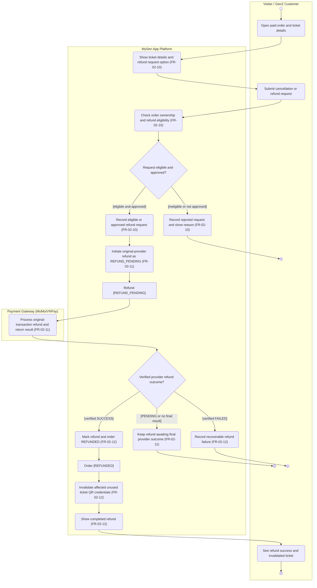

# Activity Diagram: AD-UC-02B Request cancellation and ticket refund

> **DBIZ2 · Lesson 7 · MySen App Platform**  
> **Use Case split proposal:** `UC-02B` is a proposed standalone refund Use Case, separated from the `opt` refund segment of MySen's combined purchase/refund Sequence Diagram. The W0 inventory currently lists `UC-02` for ticket purchase; it does **not** yet list `UC-02B`.

| Field | Value |
|---|---|
| AD ID | `AD-UC-02B` (proposed) |
| Use case | `UC-02B` Request cancellation and ticket refund |
| Feature | `F-02` E-Ticketing & Commerce |
| Primary actor | Visitor / GenZ Customer; supporting external actor: Payment Gateway (MoMo/VNPay) |
| Lanes | Visitor / GenZ Customer · MySen App Platform · Payment Gateway (MoMo/VNPay) |
| Inputs (L3-L5) | MySen W0 Table 2 `F-02` · W1 EARS `FR-02-10`–`FR-02-12` · MySen combined sequence `SEQ:UC02-01` Phase B (R01–R20, RA–RD) · Context Diagram version **to confirm** · Use Case ID **not yet added to W0** |
| Trigger | Customer opens a previously paid ticket order and requests cancellation/refund. |
| Preconditions | Customer can identify an order they own; the order is paid and its issued ticket is within the requested refund scope. Eligibility rules, including treatment of used tickets, remain unapproved. |
| Success end state | Provider confirms refund `SUCCESS` → Order/Refund `REFUNDED` and affected unused QR ticket credentials invalidated. |
| Failure end state(s) | Request rejected as ineligible/unapproved, or provider result `REFUND_PENDING` / `REFUND_FAILED`; successful refund and QR invalidation are not declared until confirmed. |
| FRs covered | `FR-02-10`, `FR-02-11`, `FR-02-12` (all **Should**) |
| Business rules applied | W1 EARS: check eligibility before initiating; refund to **original provider**; invalidate QR **only after confirmed successful refund**. Detailed refund policy is **TBD**, not approved. |
| Version / status | v0.2 · Draft · Pending refund policy, W0 approval and Mermaid Live check |
| Author | Nguyệt Minh (F-02) |

## 1. Diagram

Mermaid **Pattern C (`flowchart TD`)**, as allowed by the supplied workshop profile. Only business actions are shown; original sequence lifelines for Frontend, Backend, Database, and QR Ticket Service are collapsed into **MySen App Platform**. Unlike the original combined diagram, this Use Case **starts at the refund request**, not at the purchase of a ticket.

**Reading notes**

- **No arrow from UC-02A to this start**: the refund is a **later independent user goal**, not a step that always follows buying a ticket. The input is a previously `PAID` order with issued ticket(s).
- `d1` represents a **policy gate**; the refund window, used-ticket rule and whether manual approval is required are **open**, not fabricated. If a human approver is introduced, its actor lane must be added only after W0/Context are updated.
- `FR-02-11` explicitly keeps the refund `REFUND_PENDING` until a provider result. **Only `FR-02-12` authorizes `REFUNDED` and QR invalidation** upon verified success. No early invalidation is shown.
- `d2` shows the **immediate received outcome**. A late provider result for a previously pending refund requires an additional asynchronous callback path/Use Case or a later extension, currently unapproved (§6).

## 2. Node trace

| Node | Kind | Text / purpose | Traces to |
|---|---|---|---|
| `start` | Initial | Start refund request | Proposed `UC-02B`; `FR-02-10` |
| `a1` | Actor action | Open order and ticket details | `FR-02-10`; R01 |
| `s1` | System action | Show details and refund entry | `FR-02-10`; R02–R04b |
| `a2` | Actor action | Submit refund/cancellation | `FR-02-10`; R05 |
| `s2` | System action | Validate ownership and policy | `FR-02-10`; R06–R07; **policy TBD** |
| `d1` | Decision | Eligible and approved? | `FR-02-10`; Phase B `alt` |
| `s3` | System action | Reject and explain | `FR-02-10`; R19–R20 |
| `endRejected` | Activity final | No refund initiated | `FR-02-10` |
| `s4` | System action | Record accepted request | `FR-02-10`; R08–R08r |
| `s5` | System action | Initiate provider refund; set REFUND_PENDING | `FR-02-11`; R09 |
| `o1` | Object state | Refund [REFUND_PENDING] | `FR-02-11`; W1 EARS |
| `g1` | External action | Process refund and return result | `FR-02-11`; R10–R11 |
| `d2` | Decision | Provider refund outcome? | `FR-02-11`, `FR-02-12`; provider `alt` |
| `s6` | System action | Mark refund/order REFUNDED | `FR-02-12`; R12–R13r |
| `o2` | Object state | Order [REFUNDED] | `FR-02-12` |
| `s7` | System action | Invalidate QR credentials | `FR-02-12`; R14–R16r |
| `s8` | System action | Show confirmed refund | `FR-02-12`; R17–R18 |
| `a3` | Actor action | See completed refund | `FR-02-12`; R18 |
| `endSuccess` | Activity final | Refunded / QR invalidated | `FR-02-12` |
| `s9` | System action | Retain pending status | `FR-02-11`; RA–RD |
| `endPending` | Activity final | Await later result | `FR-02-11` |
| `s10` | System action | Record recoverable failure | `FR-02-12`; W1 EARS; RA–RD |
| `endFailed` | Activity final | Refund unsuccessful, recovery needed | `FR-02-12` |

## 3. Branches and acceptance tests

The `eligible` and `approved` predicates below are **placeholders for the client's refund policy**. The examples demonstrate branching without declaring a policy as approved.

| Branch | Given | When | Then |
|---|---|---|---|
| `d1 [eligible and approved]` | Customer owns PAID order `T-101` for VND 300,000; the ticket meets a hypothetical approved policy | Customer submits a refund request that the configured rules approve | MySen records the approved request, sends VND 300,000 refund against the **original payment reference**, and marks `REFUND_PENDING`. |
| `d1 [ineligible or not approved]` | Ticket in `T-102` fails the configured eligibility check (e.g. a used ticket *if* the policy prohibits it) | Customer requests refund | No provider refund is initiated; MySen displays the verified rejection reason. |
| `d2 [verified SUCCESS]` | `T-101` has refund `REFUND_PENDING`, two unused QR tickets, provider reference `TX-101` | The original MoMo transaction returns authenticated SUCCESS for the approved refund | Order/refund become `REFUNDED`; both affected QR credentials are invalidated; success appears to customer. |
| `d2 [PENDING or no final result]` | `T-103` has a submitted refund of VND 200,000 | Gateway returns PENDING or no final outcome | State stays `REFUND_PENDING`; affected QR is **not** declared invalidated; user sees pending status. Later reconciliation is an open question. |
| `d2 [verified FAILED]` | `T-104` has a `REFUND_PENDING` transaction | Gateway returns verified FAILED | MySen records a recoverable failed status; does **not** mark order REFUNDED or invalidate the QR as a successful refund. |

## 4. Object states used

| Object | States in this diagram | Full state list (all diagrams) |
|---|---|---|
| Order | `PAID` (precondition) → `REFUNDED` (success) | W1 uses `PENDING`, `PAID`, `EXPIRED`, `REFUNDED`. See UC-02A. |
| Refund transaction / request | `REFUND_PENDING`, `REFUNDED` / SUCCESS, recoverable failed status | `FR-02-11` and `FR-02-12`. Sequence also says `REFUND_FAILED` and mentions `REVIEWING`, but final enum/policy require approval. |
| E-ticket QR credential | Issued & valid before successful refund → invalidated following verified successful refund | W1 `FR-02-09`, `FR-02-12`; formal ticket status name (`INVALIDATED` versus `REFUNDED`) **unconfirmed**. |

## 5. Screens touched

**Screen IDs are intentionally not allocated** before Lesson 8. The actor actions are documented for screen derivation.

| Actor action | Screen ID |
|---|---|
| Open order history and ticket details | TBD in Lesson 8 |
| Submit cancellation/refund request | TBD in Lesson 8 |
| View rejected, pending, failed or successful refund | TBD in Lesson 8 |

## 6. Open questions

| # | Question | Blocking? | Default applied in draft |
|---|---|---|---|
| 1 | **[NEEDS CLARIFICATION]** What is the refund window, and are used/partially used/expired tickets refundable? | **Yes — eligibility** | Abstract decision `d1` only; no concrete cut-off or exclusion is invented. |
| 2 | **[NEEDS CLARIFICATION]** Is refund automatically approved or reviewed manually? If reviewed, which **existing** actor handles it, and what is the `REVIEWING` status? | **Yes — actor / workflow** | `d1` combines eligibility and approval; no unapproved Staff lane added. |
| 3 | **[NEEDS CLARIFICATION]** What job processes a later SUCCESS/FAILED callback when an earlier refund remains `REFUND_PENDING`? | **Yes — money consistency** | Document ends pending; later callback is not silently assumed completed. |
| 4 | **[NEEDS CLARIFICATION]** Are refund-provider webhook authenticity, replay handling and idempotency covered by F-02 refund FRs or a new FR? | **Yes — technical requirements** | Do not pretend purchase callback `FR-02-07` covers refund semantics. |
| 5 | **[NEEDS CLARIFICATION]** Is QR invalidation transactional with refund finalization? What if the provider succeeds but QR invalidation fails? | **Yes — correctness** | State transition and invalidation shown sequentially; failure compensation not specified. |
| 6 | **[NEEDS CLARIFICATION]** Should a partial refund apply to individual ticket items or only all tickets on an order? | Yes — scope | The diagram uses **affected unused** tickets, without asserting item-level partial refunds are allowed. |
| 7 | **[NEEDS CLARIFICATION]** Add `UC-02B` to W0 Table 1 and map it to `F-02`; split Phase B into its own Sequence Diagram and update `activity-index.md`. | Yes — traceability | Proposed new sub-use-case ID, not yet formally baselined. |
| 8 | **[NEEDS CLARIFICATION]** Confirm Context Diagram version and the payment provider name as external lane. | No — document baseline | Standard assigned lane name retained; source version TBD. |

## 7. Verification log

| Check | Result | By | Date |
|---|---|---|---|
| Renders on mermaid.live | **Pending direct browser render**. Pattern C syntax audited offline. | Draft audit | 2026-11-01 |
| Every decision has guards on outgoing flows, no overlap/no gap | Draft check: `d1` 2, `d2` 3 = **5 labelled branches**; open business-policy choices documented in §6. | Draft audit | 2026-11-01 |
| No action has two incoming flows | Draft check: all action nodes have a single incoming control flow. | Draft audit | 2026-11-01 |
| Every fork has a matching join | N/A; no confirmed parallel actions. | Draft audit | 2026-11-01 |
| Every system action cites an FR | Draft check: **10/10** MySen system actions cite an FR. | Draft audit | 2026-11-01 |
| Every FR of this Use Case appears | **3/3** `FR-02-10`–`FR-02-12`; all Should. | Draft audit | 2026-11-01 |
| Lane names match the Context Diagram | Assigned lane names used; **Context version/actor alignment pending confirmation**. | Draft audit | 2026-11-01 |
| Sequence names and FR IDs consistent; `alt` becomes `decision` | Phase B R01–R20/RA–RD mapped at business level; requested split of Sequence still pending. | Draft audit | 2026-11-01 |
| AI Critic and Peer Review | **Pending classroom Critic prompt and actual peer review**. Open questions must be resolved or owned. | Nguyệt Minh / reviewers | TBD |

---

**Sources:** DBIZ2 Lesson 7 `activity-diagram-template.md`; `mermaid-activity-patterns.md` Pattern C; LabDesk `AD-UC-01.md`; MySen `W0_Scope`, `W1_FunctionList` in `FL-Cost-Workshop (4)`; `SEQ:UC02-01` Phase B in `MySen_UC02_UML (1)-Trang-8.drawio.pdf`. UML Activity notation: OMG UML 2.5.1, Clause 15.
