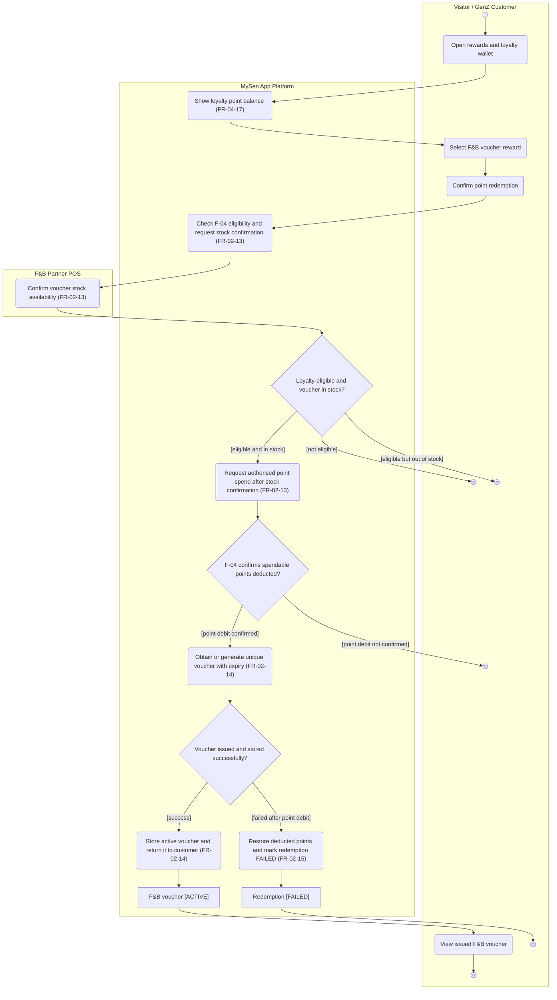

# Activity Diagram: AD-UC-02C Redeem loyalty points for an F&B voucher

> **DBIZ2 · Lesson 7 · MySen App Platform**  
> **Use Case split proposal:** `UC-02C` is a *new proposed* F-02 sub-use-case. Its business goal also touches W0's existing `UC-05 Earn Points & Redeem Loyalty Rewards` under `F-04`; ownership and Use Case relationships must be reconciled before the W0 baseline is updated. **Point deduction has no explicit standalone F-04 FR in the supplied W1.** The gap is documented below, not concealed by a made-up ID.

| Field | Value |
|---|---|
| AD ID | `AD-UC-02C` (proposed) |
| Use case | `UC-02C` Redeem loyalty points for an F&B voucher |
| Feature | `F-02` E-Ticketing & Commerce (voucher issue) with dependency on `F-04` Gamification & Loyalty Engine (wallet/eligibility/point spend) |
| Primary actor | Visitor / GenZ Customer |
| Lanes | Visitor / GenZ Customer · MySen App Platform · F&B Partner POS (external partner-service interface **to confirm**) |
| Inputs (L3-L5) | W0 Table 1 `UC-05` (currently loyalty redemption, F-04) · W0 Table 2 `F-02` / `F-04` · W1 `FR-02-13`, `FR-02-14`, `FR-02-15`; `FR-04-17` (wallet display) · Sequence `SEQ:VCH-01` referenced in W1 (original source document/version to confirm) · MySen Context version **to confirm** |
| Trigger | Visitor selects an available F&B reward and requests exchange of spendable loyalty points for a voucher. |
| Preconditions | Customer has a loyalty wallet. An F-04 eligibility/spend-authorisation outcome must be available; exact FR for authorising/deducting points is **missing in W1**. |
| Success end state | After authorised point debit and partner voucher availability, a unique F&B voucher with expiration is stored for the customer in the active/usable state. |
| Failure end state(s) | Ineligible / out of stock: no point debit; spend not authorised: no voucher; debit completed but issuance failed: equivalent spendable points restored and redemption `FAILED`, no active voucher issued. |
| FRs covered | `FR-02-13`, `FR-02-14`, `FR-02-15` (all **Should**) + `FR-04-17` (wallet display, **Must**). **Missing:** explicit wallet spend/debit FR in F-04. |
| Business rules applied | W1: check partner voucher stock **before** point deduction; issue only after authorised point debit; compensate a debit if issuance fails. Detailed loyalty eligibility, inventory reservation and duplicate-request rules unconfirmed. |
| Version / status | v0.2 · Draft · **FR gap blocking baseline** · Pending W0 and Mermaid Live checks |
| Author | Nguyệt Minh (F-02), dependency to confirm with F-04 owner |

## 1. Diagram

Mermaid **Pattern C (`flowchart TD`)**, with the authorised actor/system/external service lanes. `F-04` is **not a separate swimlane** because it is an internal part of the one **MySen App Platform** system. The `F&B Partner POS` lane stands for the configured partner availability endpoint **only if** that endpoint actually is the POS; the source W1 uses the broader term **F&B partner service** (§6).

**Reading notes**

- The green path requires **both** eligibility confirmation and voucher availability **before any point deduction** (`FR-02-13`). The precise F-04 debit step is a **traceability gap**: `s3` is the cross-feature request implied by W1's *“before requesting any spendable-point deduction”*, **not evidence that an F-04 spend FR already exists**.
- `d2` cannot be treated as a confirmed transaction without a wallet-spend specification. This is why §6 marks a **blocking action for the F-04 owner/integrator**. If a debit is not confirmed, the flow ends without calling voucher issuance.
- `FR-02-15` compensates **only** when points **have already been deducted** and voucher issuance later fails. That is why `s6` is downstream of the `[point debit confirmed]` branch, never used for insufficient balance or unavailable stock.
- This Use Case ends at **voucher issuance**, not scanning/using the voucher at the F&B outlet. W1 `FR-02-16` and `FR-02-17` concern **POS redemption and single-use enforcement** and require their own Use Case/Activity treatment if Must/Should scope calls for it.

## 2. Node trace

| Node | Kind | Text / purpose | Traces to |
|---|---|---|---|
| `start` | Initial | Start point-for-voucher exchange | Proposed `UC-02C`; W0 `UC-05` dependency |
| `a1` | Actor action | Open rewards and wallet | `FR-04-17` |
| `s1` | System action | Show wallet balance | `FR-04-17` (Must) |
| `a2` | Actor action | Select voucher | `FR-02-13` |
| `a3` | Actor action | Confirm point redemption request | `FR-02-13`; F-04 spend FR **missing** |
| `s2` | System action | Get F-04 eligibility and check partner stock | `FR-02-13`; F-04 eligibility/spend FR **not explicit** |
| `p1` | External action | Confirm stock availability | `FR-02-13`; partner service/POS mapping TBD |
| `d1` | Decision | Eligible and in stock? | `FR-02-13`; dependency on F-04 eligibility |
| `endNotEligible` | Activity final | No redemption; eligibility failed | `FR-02-13` eligibility precondition; exact F-04 FR TBD |
| `endOutOfStock` | Activity final | No redemption; reward unavailable | `FR-02-13` |
| `s3` | System action | Request authorised point spend | `FR-02-13` (ordering/integration boundary) → **missing explicit F-04 spend/debit FR** |
| `d2` | Decision | Has point deduction been confirmed? | `FR-02-14` precondition; **missing explicit F-04 spend/debit FR** |
| `endDebitNotApproved` | Activity final | Point spend not confirmed; no voucher issued | `FR-02-14` precondition; F-04 FR TBD |
| `s4` | System action | Generate or obtain voucher with expiry | `FR-02-14` |
| `d3` | Decision | Voucher issued and stored? | `FR-02-14`, `FR-02-15` |
| `s5` | System action | Store ACTIVE voucher and return it | `FR-02-14`; active-voucher requirement from `FR-02-15` |
| `o1` | Object state | F&B voucher [ACTIVE] | `FR-02-15` (must **not** create active voucher on failure); `FR-02-14` (issue) |
| `a4` | Actor action | View issued voucher | `FR-02-14` |
| `endSuccess` | Activity final | Voucher issued and points spent | `FR-02-14` |
| `s6` | System action | Restore spent points and mark redemption FAILED | `FR-02-15` |
| `o2` | Object state | Redemption [FAILED] | `FR-02-15` |
| `endIssueFailed` | Activity final | Compensated issuance failure | `FR-02-15` |

## 3. Branches and acceptance tests

One row per outgoing decision edge. The **coin values and item names are synthetic test data**; they do not establish an approved price, eligibility threshold or inventory rule.

| Branch | Given | When | Then |
|---|---|---|---|
| `d1 [eligible and in stock]` | Wallet `W-201` has 800 spendable points, reward `FB-01` is configured to cost 500 points, eligibility is confirmed, and partner reports 5 remaining vouchers | Visitor confirms redemption of FB-01 | MySen may request an authorised 500-point deduction; no voucher issued before a confirmed debit. |
| `d1 [not eligible]` | `W-202` has 100 spendable points for a hypothetical 500-point reward, and F-04 denies eligibility | Visitor selects that reward | No debit request proceeds and no ACTIVE voucher is created. The precise eligibility FR and user message require confirmation. |
| `d1 [eligible but out of stock]` | Wallet has 800 spendable points and F-04 confirms eligibility; partner reports zero available FB-01 vouchers | Visitor confirms exchange | MySen does **not** request point deduction; no voucher issued. |
| `d2 [point debit confirmed]` | F-04 has an authorised 500-point spend request for `W-201` | F-04 confirms that exactly 500 spendable points were deducted | MySen proceeds to obtain or generate the voucher and its expiry according to `FR-02-14`. |
| `d2 [point debit not confirmed]` | Request `R-202` is eligible and partner stock is available | F-04 returns debit rejected / no positive confirmation | MySen does not issue a voucher; outcome must be logged under an F-04 spend requirement to be added/confirmed. |
| `d3 [success]` | Authorised debit of 500 points is confirmed; a voucher code `FBV-201` and expiry are successfully stored | Issuance finishes | FBV-201 becomes an ACTIVE usable voucher linked to this customer and is displayed; no compensation is triggered. |
| `d3 [failed after point debit]` | 500 points have already been deducted for request `R-203`; voucher issuance or persistence fails | MySen detects the issuance failure | Exactly 500 points are restored, redemption becomes FAILED, and **no ACTIVE voucher** exists for R-203. |

## 4. Object states used

| Object | States in this diagram | Full state list (all diagrams) |
|---|---|---|
| Loyalty wallet | Sufficient/insufficient spendable points (conditions, **not formal status enum**); balance decreases only after authorised deduction | Wallet coin balance and transactions are displayed by `FR-04-17`. **Spend/debit FR is missing** in F-04 W1; no approved wallet-spend state list supplied. |
| Voucher | `[ACTIVE]` created only on successful issuance; not created as ACTIVE on issuance failure | W1 `FR-02-14`, `FR-02-15`; `REDEEMED` mentioned in `FR-02-16`; expired / invalid states used by `FR-02-17` but exact enum names are TBD. |
| Redemption attempt | `[FAILED]` after compensation; successful issue state not formally named | W1 `FR-02-15`; request-idempotency and retry state model not supplied. |

## 5. Screens touched

**Lesson 7:** do not assign invented Screen IDs. Fill them from the approved Screen List in Lesson 8.

| Actor action | Screen ID |
|---|---|
| Open rewards and loyalty wallet | TBD in Lesson 8 |
| Choose F&B voucher and confirm redemption | TBD in Lesson 8 |
| View voucher issued, stock/eligibility rejection or issuance failure | TBD in Lesson 8 |

## 6. Open questions

| # | Question | Blocking? | Default applied in draft |
|---|---|---|---|
| 1 | **[NEEDS CLARIFICATION]** W0 currently assigns redeeming loyalty rewards to `UC-05` / `F-04`. Will `UC-02C` become a separate F-02 Use Case, a specialised extension of UC-05, or stay entirely under UC-05? | **Yes — ownership/Use Case traceability** | Proposed UC-02C for F&B voucher issuance; reference UC-05 for wallet semantics. |
| 2 | **[NEEDS CLARIFICATION]** Which F-04 FR explicitly **authorises and atomically deducts spendable points**, rejects insufficient balances, and prevents duplicate deduction? The supplied `FR-04-01`–`FR-04-18` do not provide an explicit spend/debit requirement. | **Yes — missing business requirement** | Diagram shows the cross-feature request/confirmation, not an invented F-04 FR number. Add/update W1 before marking ready. |
| 3 | **[NEEDS CLARIFICATION]** Is stock confirmation provided by the **F&B Partner POS** or a separate external partner service? Is stock reserved prior to debit? | **Yes — Context Diagram and inventory** | Assigned `F&B Partner POS` lane used provisionally as external availability endpoint; no stock-reservation guarantee inferred. |
| 4 | **[NEEDS CLARIFICATION]** Does F-02 generate voucher codes internally or obtain codes from the external F&B partner? How is failure determined? | **Yes — interface/API** | Single business-level action `s4` covers “obtain or create” from actual W1 EARS. |
| 5 | **[NEEDS CLARIFICATION]** How are duplicated requests / concurrent balance spends made idempotent? Does point rollback require a compensating transaction and audit trail? | **Yes — financial/loyalty consistency** | W1 `FR-02-15` is shown; no mechanism, SLA or retry guarantee invented. |
| 6 | **[NEEDS CLARIFICATION]** Voucher expiry timestamp, partner/outlet binding and usage policies (FR-02-16/17) need their own Use Case/activity or are separate acceptance criteria? | No for **issuance** only | UC-02C ends at issuance; outlet redemption is out of scope here. |
| 7 | **[NEEDS CLARIFICATION]** Confirm formal object-state names and whether successful voucher issue can be described as `[ACTIVE]`; W1 `FR-02-15` uses “active voucher” but does not enumerate all states. | No for draft | Use `[ACTIVE]` and `[FAILED]` as explicitly used in W1; do not assert a full state machine. |
| 8 | **[NEEDS CLARIFICATION]** Add/approve `UC-02C` and its F-02/F-04 relationship in W0 Table 1, Use Case Diagram, `activity-index.md`, and separate/confirm `SEQ:VCH-01` Phase 2 ownership. | **Yes — submission baseline** | Proposed ID; not yet represented in original W0. |

## 7. Verification log

| Check | Result | By | Date |
|---|---|---|---|
| Renders on mermaid.live | **Pending direct browser render**; Pattern C used and syntax audited offline. | Draft audit | 2026-11-01 |
| Every decision has guards on all outgoing flows, no overlap/no gap | Draft check: `d1` 3, `d2` 2, `d3` 2 = **7 labelled branches**. | Draft audit | 2026-11-01 |
| No action has two incoming flows | Draft check: all actions have a single incoming control edge. | Draft audit | 2026-11-01 |
| Every fork has a matching join | N/A; no confirmed parallel branch. | Draft audit | 2026-11-01 |
| Every system action cites an FR | Draft check: **6/6** MySen action nodes cite a W1 FR; `s3` depends on a **missing F-04 spend FR** (explicitly flagged). | Draft audit | 2026-11-01 |
| Every applicable F-02 FR appears | **3/3** `FR-02-13`–`FR-02-15`; supporting F-04 wallet display `FR-04-17` present. **F-04 spend/debit FR absent**: not full business-coverage approval. | Draft audit | 2026-11-01 |
| Lane names match approved Context Diagram | Assigned lane names used; **POS vs external partner service must be confirmed** before Pass. | Draft audit | 2026-11-01 |
| Related Sequence has same names and FR IDs | W1 cites `SEQ:VCH-01` Phase 2; source sequence PDF/approved path for this use case **not supplied in current UC-02 sequence**, so full comparison remains pending. | Draft audit | 2026-11-01 |
| AI Critic and Peer Review | **Pending workshop Critic prompt and external peer review**; W0 ownership and missing FR are blockers. | Nguyệt Minh / F-04 owner / reviewers | TBD |

---

**Sources:** DBIZ2 Lesson 7 `activity-diagram-template.md`; `mermaid-activity-patterns.md` Pattern C; LabDesk `AD-UC-01.md` worked example; MySen `W0_Scope` and `W1_FunctionList` in supplied `FL-Cost-Workshop (4)`; W1 source reference to `SEQ:VCH-01` Phase 2 (original voucher sequence itself still needs to be supplied/confirmed). UML Activity notation: OMG UML 2.5.1, Clause 15.
