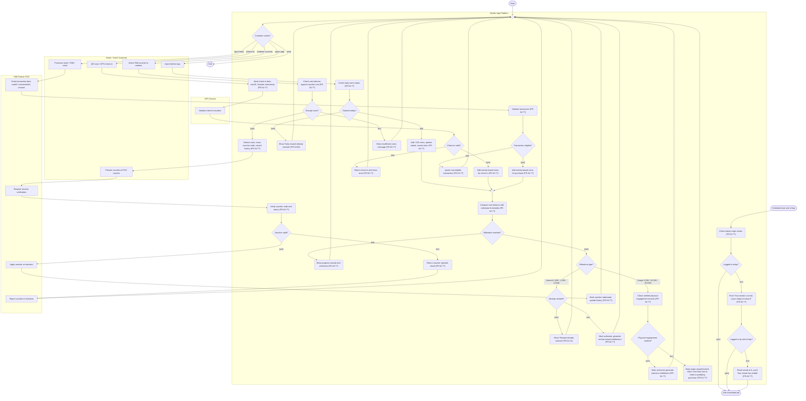

# AD-UC-05: Tích điểm & Đổi quà Loyalty (F-04)

**Người phụ trách:** Bảo Ngân
**Phạm vi:** Daily login streak (+100 xu), Milestone thường và mốc lớn (yêu cầu verified visit), đổi xu lấy Voucher F&B tại quầy POS đối tác.
**Nguồn đối chiếu:** `F04_Loyalty_Sequence.png` (Phase 1 Earn Coins, Phase 2 Streak Management, Phase 3 Milestone Reward).

> Lưu ý trạng thái: các mã FR ghi `FR-04-??` chưa được đối chiếu với bảng chức năng FR-01-01 đến FR-06-12 trong file Excel. Chỉ FR-04-06 và FR-04-11 lấy trực tiếp từ sơ đồ tuần tự. Cần điền nốt trước khi nộp.

---

## Mục 1. Swimlane và sơ đồ

| Loại làn | Làn sử dụng |
|---|---|
| Tác nhân | Visitor / GenZ Customer |
| Hệ thống của nhóm | MySen App Platform (một làn duy nhất, không tách Backend, Frontend, Database) |
| Hệ thống bên ngoài | GPS Service, F&B Partner POS |



---

## Mục 2. Bảng vết nút (Node Trace Table)

Cột "FR ID" chỉ điền sẵn hai mã đã có trong sơ đồ tuần tự. Các dòng còn lại cần đối chiếu với file Excel.

| Node | Làn | Nội dung | Loại | FR ID | Nguồn trong sequence |
|---|---|---|---|---|---|
| S1 | Hệ thống | Start | Start | n/a | n/a |
| c1 | Customer | Open MySen App | Hành động người dùng | n/a | Phase 1A |
| c2 | Customer | QR scan / GPS check-in | Hành động người dùng | n/a | Phase 1B |
| c3 | Customer | Purchase ticket / F&B / retail | Hành động người dùng | n/a | Phase 1C |
| c4 | Customer | Select F&B voucher to redeem | Hành động người dùng | n/a | Bổ sung theo phân công |
| c5 | Customer | Present voucher at POS counter | Hành động người dùng | n/a | Bổ sung theo phân công |
| m0 | Platform | Merge điểm quay lại | Merge | n/a | n/a |
| d0 | Platform | Customer action? | Decision | n/a | n/a |
| p1 | Platform | Check daily claim status | Hành động hệ thống | FR-04-?? | Phase 1A |
| d1 | Platform | Claimed today? | Decision | FR-04-?? | Phase 1A |
| p2 | Platform | Add +100 coins, update streak, record claim | Hành động hệ thống | FR-04-?? | Phase 1A |
| p3 | Platform | Show daily reward already claimed | Hành động hệ thống | FR-04-06 | Phase 1A |
| p4 | Platform | Send check-in data | Hành động hệ thống | FR-04-?? | Phase 1B |
| g1 | GPS Service | Validate check-in location | Hệ thống ngoài | n/a | Phase 1B (Validate check-in) |
| d2 | Platform | Check-in valid? | Decision | FR-04-?? | Phase 1B |
| p5 | Platform | Add activity-based coins for check-in | Hành động hệ thống | FR-04-?? | Phase 1B |
| p6 | Platform | Reject check-in and show error | Hành động hệ thống | FR-04-?? | Nhánh lỗi bổ sung |
| f1 | F&B POS | Send transaction data | Hệ thống ngoài | n/a | Phase 1C |
| p7 | Platform | Validate transaction | Hành động hệ thống | FR-04-?? | Phase 1C |
| d3 | Platform | Transaction eligible? | Decision | FR-04-?? | Phase 1C |
| p8 | Platform | Add activity-based coins for purchase | Hành động hệ thống | FR-04-?? | Phase 1C |
| p9 | Platform | Ignore non-eligible transaction | Hành động hệ thống | FR-04-?? | Nhánh lỗi bổ sung |
| m1 | Platform | Merge sau cập nhật xu | Merge | n/a | n/a |
| p10 | Platform | Compare coin balance with thresholds | Hành động hệ thống | FR-04-?? | Phase 3 |
| d4 | Platform | Milestone reached? | Decision | FR-04-?? | Phase 3 |
| p11 | Platform | Show progress toward next milestone | Hành động hệ thống | FR-04-?? | Phase 3 |
| d5 | Platform | Milestone type? | Decision | FR-04-?? | Phase 3 |
| d6 | Platform | Already claimed? | Decision | FR-04-11 | Phase 3 |
| p12 | Platform | Show reward already claimed | Hành động hệ thống | FR-04-11 | Phase 3 |
| p13 | Platform | Mark achieved, normal entitlement | Hành động hệ thống | FR-04-?? | Phase 3 |
| p14 | Platform | Check verified physical-engagement records | Hành động hệ thống | FR-04-?? | Phase 3 |
| d7 | Platform | Physical engagement verified? | Decision | FR-04-?? | Phase 3 |
| p15 | Platform | Mark achieved, premium entitlement | Hành động hệ thống | FR-04-?? | Phase 3 |
| p16 | Platform | Keep major reward locked, show prompt | Hành động hệ thống | FR-04-?? | Phase 3 |
| p17 | Platform | Check coin balance against voucher cost | Hành động hệ thống | FR-04-?? | Bổ sung theo phân công |
| d8 | Platform | Enough coins? | Decision | FR-04-?? | Bổ sung theo phân công |
| p18 | Platform | Show insufficient coins message | Hành động hệ thống | FR-04-?? | Bổ sung theo phân công |
| p19 | Platform | Deduct coins, issue voucher code, record history | Hành động hệ thống | FR-04-?? | Bổ sung theo phân công |
| f2 | F&B POS | Request voucher verification | Hệ thống ngoài | n/a | Bổ sung theo phân công |
| p20 | Platform | Verify voucher code and status | Hành động hệ thống | FR-04-?? | Bổ sung theo phân công |
| d9 | Platform | Voucher valid? | Decision | FR-04-?? | Bổ sung theo phân công |
| f3 | F&B POS | Apply voucher at checkout | Hệ thống ngoài | n/a | Bổ sung theo phân công |
| p21 | Platform | Mark voucher redeemed, update history | Hành động hệ thống | FR-04-?? | Bổ sung theo phân công |
| p22 | Platform | Return voucher rejected result | Hành động hệ thống | FR-04-?? | Bổ sung theo phân công |
| f4 | F&B POS | Reject voucher at checkout | Hệ thống ngoài | n/a | Bổ sung theo phân công |
| S2 | Platform | Scheduled job: end of day | Start | n/a | Phase 2 |
| q1 | Platform | Check today's login status | Hành động hệ thống | FR-04-?? | Phase 2 |
| dq1 | Platform | Logged in today? | Decision | FR-04-?? | Phase 2 |
| q2 | Platform | Push streak-at-risk reminder | Hành động hệ thống | FR-04-?? | Phase 2 |
| dq2 | Platform | Logged in by end of day? | Decision | FR-04-?? | Phase 2 |
| q3 | Platform | Reset streak to 0, push streak-ended | Hành động hệ thống | FR-04-?? | Phase 2 |
| E1, E2 | n/a | End | End | n/a | n/a |

---

## Mục 3. Kịch bản kiểm thử nhánh (Branch Tests)

| ID | Nút rẽ | Given | When | Then |
|---|---|---|---|---|
| BT-01 | d1 [no] | Người dùng chưa nhận thưởng hôm nay, streak hiện tại là 3 ngày | Mở MySen App và nhận thưởng ngày | Cộng 100 xu, streak tăng lên 4, ghi nhận lượt nhận trong ngày |
| BT-02 | d1 [yes] | Người dùng đã nhận thưởng hôm nay | Mở lại ứng dụng và nhận thưởng lần nữa | Không cộng xu, hiển thị "Daily reward already claimed" (FR-04-06) |
| BT-03 | d2 [yes] | Người dùng đang ở trong khu vực công viên, GPS Service xác nhận vị trí | Quét QR hoặc check-in GPS | Cộng xu theo hoạt động, hiển thị số xu nhận được |
| BT-04 | d2 [no] | Vị trí nằm ngoài phạm vi công viên hoặc mã QR không hợp lệ | Thực hiện check-in | Từ chối check-in, không cộng xu, hiển thị lỗi |
| BT-05 | d3 [yes] | POS gửi giao dịch hợp lệ có transactionID chưa dùng | Người dùng mua vé hoặc F&B | Cộng xu theo giá trị giao dịch, hiển thị "+X Coins" |
| BT-06 | d3 [no] | Giao dịch trùng transactionID hoặc không thuộc nhóm đủ điều kiện | POS gửi dữ liệu giao dịch | Bỏ qua giao dịch, không cộng xu |
| BT-07 | d4 [no] | Số dư 700 xu, mốc gần nhất là 1,000 | Số dư được cập nhật | Hiển thị tiến độ tới mốc kế tiếp, không tạo quyền lợi |
| BT-08 | d6 [no] | Số dư đạt 1,000 xu, mốc thường chưa nhận | Hệ thống so sánh với ngưỡng | Đánh dấu đạt mốc, tạo quyền lợi thưởng thường, hiển thị "Normal milestone reward unlocked!" |
| BT-09 | d6 [yes] | Số dư đạt 1,500 xu, mốc này đã nhận trước đó | Hệ thống so sánh với ngưỡng | Không tạo quyền lợi mới, hiển thị "Reward already claimed" (FR-04-11) |
| BT-10 | d7 [yes] | Số dư đạt 5,000 xu, có bản ghi verified visit | Hệ thống kiểm tra mốc lớn | Đánh dấu đạt mốc, tạo quyền lợi cao cấp, hiển thị "Major Reward Unlocked!" |
| BT-11 | d7 [no] | Số dư đạt 15,000 xu, không có bản ghi verified visit | Hệ thống kiểm tra mốc lớn | Giữ phần thưởng ở trạng thái khóa, hiển thị gợi ý đến Đầm Sen hoặc mua hàng đủ điều kiện |
| BT-12 | d8 [no] | Số dư thấp hơn giá voucher | Chọn voucher F&B để đổi | Không trừ xu, hiển thị thông báo không đủ xu, quay lại màn hình chính |
| BT-13 | d8 [yes] | Số dư đủ cho voucher | Chọn voucher F&B để đổi | Trừ xu, phát hành mã voucher, ghi lịch sử đổi |
| BT-14 | d9 [yes] | Mã voucher còn hiệu lực, chưa dùng | Đưa voucher tại quầy POS đối tác | POS áp dụng ưu đãi, voucher chuyển sang đã dùng, lịch sử được cập nhật |
| BT-15 | d9 [no] | Mã voucher đã dùng hoặc hết hạn | Đưa voucher tại quầy POS đối tác | POS từ chối, trạng thái voucher không đổi |
| BT-16 | dq1 [yes] | Người dùng đã đăng nhập trong ngày | Job chạy kiểm tra | Không gửi nhắc, kết thúc job |
| BT-17 | dq1 [no], dq2 [yes] | Chưa đăng nhập lúc kiểm tra nhưng đăng nhập trước cuối ngày | Job nhắc rồi kiểm tra lần cuối | Gửi nhắc "streak is at risk", streak được giữ nguyên |
| BT-18 | dq2 [no] | Không đăng nhập đến hết ngày | Job kiểm tra cuối ngày | Streak về 0, gửi thông báo "streak has ended" |

---

## Mục 4. Giả định và điểm cần xác nhận

1. **Làn thông báo.** Sơ đồ tuần tự có Notification Service, nhưng danh sách làn được phép của UC-05 không gồm Messaging Providers (FCM/APNs). Bản này gộp việc đẩy thông báo vào MySen App Platform. Nếu giảng viên yêu cầu thể hiện FCM/APNs, thêm một làn ngoài và hai nút tương ứng ở q2, q3.
2. **Làn Park Check-in / Ticketing-POS.** Sơ đồ tuần tự dùng một hệ thống này cho cả check-in và giao dịch. Bản này tách thành GPS Service (check-in) và F&B Partner POS (giao dịch), đúng theo làn chuẩn. Giao dịch mua vé tại cổng được coi là đi qua F&B Partner POS; cần xác nhận.
3. **Luồng đổi voucher.** Sơ đồ tuần tự chưa có luồng này. Các nút c4, c5, p17 đến p22, f2 đến f4 được dựng theo mô tả phân công và cần khớp với FR tương ứng trong Excel.
4. **Chu kỳ quay lại.** Mọi nhánh kết thúc đều đi về m0, theo ghi chú "Phases 1 and 3 repeat after every coin update". Mốc thưởng được kiểm tra sau mỗi lần cộng xu thông qua m1.
5. **Bộ ngưỡng mốc.** Lấy từ sơ đồ tuần tự: thường 1,000 / 1,500 / 2,000; lớn 5,000 / 15,000 / 25,000.

## Mục 5. Kiểm tra cú pháp

Chưa render trong môi trường này. Cần dán đoạn mã vào Mermaid Live Editor để xác nhận sơ đồ hiển thị đúng trước khi nộp.

## Mục 6. Prompt Critic cho AI rà soát

```
Bạn là reviewer nghiệp vụ và Mermaid. Rà soát sơ đồ activity AD-UC-05 sau:
1. Lỗi cú pháp flowchart TD (subgraph, nhãn có ký tự đặc biệt, mũi tên).
2. Hành động hệ thống nào thiếu mã FR ở cuối nhãn.
3. Decision nào thiếu guard rõ ràng trên mọi nhánh ra.
4. Vòng lặp lùi nào không đi qua nút merge.
5. Nút nào vi phạm danh sách làn cho phép.
6. Lỗ hổng nghiệp vụ: nhận thưởng trùng, race condition khi hai thiết bị cùng claim, hoàn xu khi voucher bị từ chối, voucher hết hạn, mốc lớn không có verified visit.
Trả về bảng: vị trí, vấn đề, mức độ, đề xuất sửa.
```

Kết quả rà soát AI: _chưa thực hiện_.

## Mục 7. Peer Review

Tệp nhận xét: `review-TeamXX.md` _(chưa có)_.
