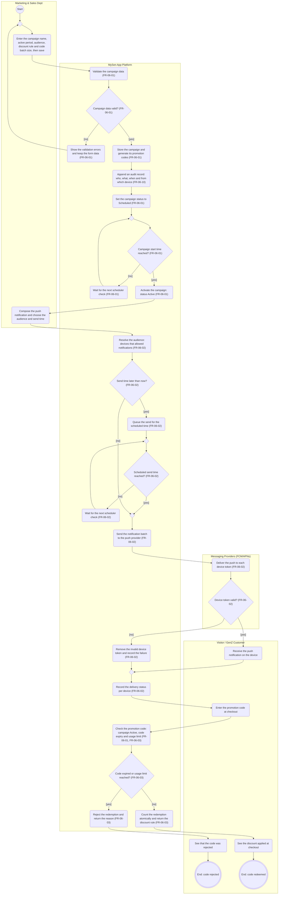

# AD-UC-08 — Manage Marketing & Promotion Campaigns (Quản lý chiến dịch Marketing & Push)

| Thuộc tính | Giá trị |
|---|---|
| Use case | UC-08 — Manage Marketing & Promotion Campaigns (Quản lý chiến dịch Marketing & Push) |
| Feature | F-06 Admin Operations & Analytics |
| Người phụ trách | Lê Thành Hiệp (MSSV 2411560014) |
| FR trong phạm vi | FR-06-01, FR-06-02, FR-06-03, FR-06-10 |
| Nguồn dữ liệu | `Group_F_Function_List___Cost_DBIZ2.xlsx` — sheets *Scope*, *FunctionList*, *Prioritization* (Initial & Effective priority) |
| Sequence trong Excel | S-06 (campaign), S-06-alt1 (giới hạn mã), S-07 (push) |
| Trạng thái | Bước 1–5 hoàn tất bản nháp · Peer Review: chờ nhóm bạn (xem Mục 7) |

---

## Mục 1 — Sơ đồ Activity (Bước 1 & 2)

### 1.1 Làn sử dụng (Bước 1)

| Làn (đúng tên chuẩn) | Loại làn | Vai trò trong UC | Số nút |
|---|---|---|---|
| Marketing & Sales Dept | Tác nhân | Nhân viên Marketing tạo campaign và soạn push | 4 |
| MySen App Platform | Hệ thống của bạn | Kiểm tra/lưu campaign, sinh mã, ghi audit, lập lịch, gửi push, kiểm tra mã | 25 |
| Messaging Providers (FCM/APNs) | Hệ thống bên ngoài | FCM/APNs chuyển push tới token thiết bị (FR-06-02) | 2 |
| Visitor / GenZ Customer | Tác nhân | Nhận push và dùng mã khuyến mãi khi thanh toán | 6 |

Không dùng: IT & Technical Dept, Google Identity, Partner, Staff & Admin, Indie Artists, Payment Gateway, GPS Service, F&B Partner POS. Không có làn kỹ thuật (Backend/Frontend/Database/Web App).

### 1.2 Mã Mermaid (Bước 2)



**Chú giải ký hiệu:** `st((…))` = Start · `en(((…)))` = End · `s1("…")` = hành động · `d1{"…"}` = quyết định (mỗi cạnh ra có guard) ·
`m1{" "}` = merge (nút hợp nhất, đích của mọi vòng lặp lùi). Mỗi `subgraph` là một làn. Mermaid không có swimlane thật nên khung làn có thể chồng lên nhau khi render — đây là hạn chế hiển thị, không phải lỗi cú pháp.

---

## Mục 2 — Node Trace Table (Bước 3)

### 2.1 Bảng vết: nút → FR (Excel, sheet *FunctionList*)

| Node ID | Làn | Loại | Nhãn trên sơ đồ | FR ID | Tên FR (sheet FunctionList) | L3 liên quan | Priority (Initial → Effective) | Ghi chú |
|---|---|---|---|---|---|---|---|---|
| st | Marketing & Sales Dept | Start | Start | — | — | — | — | Nút điều khiển – điểm bắt đầu, không phải hành động |
| m1 | Marketing & Sales Dept | Merge | (trống) | — | — | — | — | Nút điều khiển – hợp nhất luồng / đích của vòng lặp lùi |
| k1 | Marketing & Sales Dept | Action | Enter the campaign name, active period, audience, discount rule and code batch size, then save | FR-06-01 | Manage marketing campaigns and promotion codes | FR-06-01-FE | Must | Hành động của tác nhân – ánh xạ tới FR mà nó kích hoạt |
| k2 | Marketing & Sales Dept | Action | Compose the push notification and choose the audience and send time | FR-06-02 | Send a push notification to an audience | FR-06-02-FE | Should | Hành động của tác nhân – ánh xạ tới FR mà nó kích hoạt |
| s1 | MySen App Platform | Action | Validate the campaign data (FR-06-01) | FR-06-01 | Manage marketing campaigns and promotion codes | FR-06-01-BE | Must |  |
| d1 | MySen App Platform | Decision | Campaign data valid? (FR-06-01) | FR-06-01 | Manage marketing campaigns and promotion codes | FR-06-01-BE | Must |  |
| s2 | MySen App Platform | Action | Show the validation errors and keep the form data (FR-06-01) | FR-06-01 | Manage marketing campaigns and promotion codes | FR-06-01-BE<br>FR-06-01-FE | Must |  |
| s3 | MySen App Platform | Action | Store the campaign and generate its promotion codes (FR-06-01) | FR-06-01 | Manage marketing campaigns and promotion codes | FR-06-01-BE | Must |  |
| s4 | MySen App Platform | Action | Append an audit record: who, what, when and from which device (FR-06-10) | FR-06-10 | Record an audit log of admin actions | FR-06-10-BE | Must |  |
| s5 | MySen App Platform | Action | Set the campaign status to Scheduled (FR-06-01) | FR-06-01 | Manage marketing campaigns and promotion codes | FR-06-01-BE | Must |  |
| m2 | MySen App Platform | Merge | (trống) | — | — | — | — | Nút điều khiển – hợp nhất luồng / đích của vòng lặp lùi |
| d2 | MySen App Platform | Decision | Campaign start time reached? (FR-06-01) | FR-06-01 | Manage marketing campaigns and promotion codes | FR-06-01-BE | Must |  |
| s6 | MySen App Platform | Action | Wait for the next scheduler check (FR-06-01) | FR-06-01 | Manage marketing campaigns and promotion codes | FR-06-01-BE | Must |  |
| s7 | MySen App Platform | Action | Activate the campaign: status Active (FR-06-01) | FR-06-01 | Manage marketing campaigns and promotion codes | FR-06-01-BE | Must |  |
| s8 | MySen App Platform | Action | Resolve the audience: devices that allowed notifications (FR-06-02) | FR-06-02 | Send a push notification to an audience | FR-06-02-BE | Should |  |
| d3 | MySen App Platform | Decision | Send time later than now? (FR-06-02) | FR-06-02 | Send a push notification to an audience | FR-06-02-BE | Should |  |
| s9 | MySen App Platform | Action | Queue the send for the scheduled time (FR-06-02) | FR-06-02 | Send a push notification to an audience | FR-06-02-BE | Should |  |
| m3 | MySen App Platform | Merge | (trống) | — | — | — | — | Nút điều khiển – hợp nhất luồng / đích của vòng lặp lùi |
| d4 | MySen App Platform | Decision | Scheduled send time reached? (FR-06-02) | FR-06-02 | Send a push notification to an audience | FR-06-02-BE | Should |  |
| s10 | MySen App Platform | Action | Wait for the next scheduler check (FR-06-02) | FR-06-02 | Send a push notification to an audience | FR-06-02-BE | Should |  |
| m4 | MySen App Platform | Merge | (trống) | — | — | — | — | Nút điều khiển – hợp nhất luồng / đích của vòng lặp lùi |
| s11 | MySen App Platform | Action | Send the notification batch to the push provider (FR-06-02) | FR-06-02 | Send a push notification to an audience | FR-06-02-BE<br>FR-06-02-INT | Should |  |
| s12 | MySen App Platform | Action | Remove the invalid device token and record the failure (FR-06-02) | FR-06-02 | Send a push notification to an audience | FR-06-02-INT | Should |  |
| m5 | MySen App Platform | Merge | (trống) | — | — | — | — | Nút điều khiển – hợp nhất luồng / đích của vòng lặp lùi |
| s13 | MySen App Platform | Action | Record the delivery status per device (FR-06-02) | FR-06-02 | Send a push notification to an audience | FR-06-02-BE | Should |  |
| s14 | MySen App Platform | Action | Check the promotion code: campaign Active, code expiry and usage limit (FR-06-01, FR-06-03) | FR-06-01<br>FR-06-03 | Manage marketing campaigns and promotion codes<br>Prevent a promotion code from being redeemed beyond its limit | FR-06-01-BE<br>FR-06-03-BE | Must<br>Must | Code-check endpoint cho checkout (FR-06-01-BE) |
| d6 | MySen App Platform | Decision | Code expired or usage limit reached? (FR-06-03) | FR-06-03 | Prevent a promotion code from being redeemed beyond its limit | FR-06-03-BE | Must |  |
| s15 | MySen App Platform | Action | Reject the redemption and return the reason (FR-06-03) | FR-06-03 | Prevent a promotion code from being redeemed beyond its limit | FR-06-03-BE | Must |  |
| s16 | MySen App Platform | Action | Count the redemption atomically and return the discount rule (FR-06-03) | FR-06-03 | Prevent a promotion code from being redeemed beyond its limit | FR-06-03-BE | Must |  |
| p1 | Messaging Providers (FCM/APNs) | Action | Deliver the push to each device token (FR-06-02) | FR-06-02 | Send a push notification to an audience | FR-06-02-INT | Should |  |
| d5 | Messaging Providers (FCM/APNs) | Decision | Device token valid? (FR-06-02) | FR-06-02 | Send a push notification to an audience | FR-06-02-INT | Should |  |
| v1 | Visitor / GenZ Customer | Action | Receive the push notification on the device | FR-06-02 | Send a push notification to an audience | FR-06-02-INT | Should | Chỉ thiết bị đã cho phép thông báo |
| v2 | Visitor / GenZ Customer | Action | Enter the promotion code at checkout | FR-06-01 | Manage marketing campaigns and promotion codes | FR-06-01-BE | Must | Checkout thuộc F-02, gọi code-check của FR-06-01 |
| v3 | Visitor / GenZ Customer | Action | See that the code was rejected | FR-06-03 | Prevent a promotion code from being redeemed beyond its limit | FR-06-03-BE | Must | Hành động của tác nhân – ánh xạ tới FR mà nó kích hoạt |
| v4 | Visitor / GenZ Customer | Action | See the discount applied at checkout | FR-06-01 | Manage marketing campaigns and promotion codes | FR-06-01-BE | Must | Hành động của tác nhân – ánh xạ tới FR mà nó kích hoạt |
| en1 | Visitor / GenZ Customer | End | End: code rejected | — | — | — | — | Nút điều khiển – điểm kết thúc, không phải hành động |
| en2 | Visitor / GenZ Customer | End | End: code redeemed | — | — | — | — | Nút điều khiển – điểm kết thúc, không phải hành động |

### 2.2 Ma trận phủ FR

| FR ID | Tên FR | Priority | Nút hệ thống / bên ngoài (có FR trong nhãn) | Nút tác nhân liên quan | Ghi chú |
|---|---|---|---|---|---|
| FR-06-01 | Manage marketing campaigns and promotion codes | Must | s1, d1, s2, s3, s5, d2, s6, s7, s14 | k1, v2, v4 |  |
| FR-06-02 | Send a push notification to an audience | Should | s8, d3, s9, d4, s10, s11, s12, s13, p1, d5 | k2, v1 |  |
| FR-06-03 | Prevent a promotion code from being redeemed beyond its limit | Must | s14, d6, s15, s16 | v3 |  |
| FR-06-10 | Record an audit log of admin actions | Must | s4 | — | Chỉ ghi audit lúc tạo (s4); sửa/kết thúc campaign dùng chung đường lưu — xem A-03 |

---

## Mục 3 — Branch Tests (Bước 4)

| Test ID | Nút | Guard | Luồng đi qua | Given | When | Then | FR |
|---|---|---|---|---|---|---|---|
| BT-08-01 | d1 | [no] | d1→s2→m1→k1 | Nhân viên Marketing nhập chiến dịch "Halloween Night 2026" với ngày bắt đầu 31/10/2026 và ngày kết thúc 30/10/2026 | bấm Lưu | Hệ thống báo lỗi khoảng thời gian, KHÔNG lưu campaign, KHÔNG sinh mã, KHÔNG ghi audit; form giữ nguyên dữ liệu đã nhập | FR-06-01 |
| BT-08-02 | d1 | [yes] | d1→s3→s4→s5→m2 | Chiến dịch "Halloween Night 2026": 31/10/2026 00:00 → 02/11/2026 23:59, đối tượng khách 16–25 tuổi, giảm 20%, 500 mã | bấm Lưu | Campaign được lưu, sinh đủ 500 mã (ví dụ HALLOWEEN20-0001…), ghi 1 bản audit (ai, làm gì, lúc nào, thiết bị nào), trạng thái = Scheduled | FR-06-01, FR-06-10 |
| BT-08-03 | d2 | [no] | d2→s6→m2→d2 | Campaign đang Scheduled, bây giờ là 28/10/2026 09:00 (trước 31/10 00:00) | scheduler chạy lần kiểm tra kế tiếp | Trạng thái vẫn là Scheduled, mã chưa dùng được, hệ thống chờ lần kiểm tra sau | FR-06-01 |
| BT-08-04 | d2 | [yes] | d2→s7→k2 | Campaign đang Scheduled, đồng hồ hệ thống là 31/10/2026 00:00:05 | scheduler chạy lần kiểm tra kế tiếp | Trạng thái chuyển sang Active, các mã có thể được dùng khi thanh toán | FR-06-01 |
| BT-08-05 | d3 | [no] | d3→m4→s11 | Marketing soạn push "Halloween Night giảm 20%" cho nhóm 1.200 thiết bị đã bật thông báo, chọn "Gửi ngay" | hệ thống resolve đối tượng | Không đưa vào hàng chờ, đi thẳng bước gửi batch tới nhà cung cấp push | FR-06-02 |
| BT-08-06 | d3 | [yes] | d3→s9→m3 | Marketing chọn gửi lúc 18:00 ngày 31/10/2026 | hệ thống resolve đối tượng | Lượt gửi được đưa vào hàng chờ với giờ gửi 18:00, chưa gửi ngay | FR-06-02 |
| BT-08-07 | d4 | [no] | d4→s10→m3→d4 | Lượt gửi đã queue cho 18:00, bây giờ là 17:59:30 | scheduler chạy kiểm tra | Chưa gửi, chờ lần kiểm tra kế tiếp | FR-06-02 |
| BT-08-08 | d4 | [yes] | d4→m4→s11 | Lượt gửi đã queue cho 18:00, bây giờ là 18:00:10 | scheduler chạy kiểm tra | Hệ thống đưa batch 1.200 thiết bị sang bước gửi tới nhà cung cấp push | FR-06-02 |
| BT-08-09 | d5 | [no] | d5→s12→m5 | Một người dùng đã gỡ app; FCM trả lỗi token không còn đăng ký (UNREGISTERED) | FCM xử lý batch | Hệ thống xóa token đó, ghi trạng thái thất bại và không gửi lại cho token này | FR-06-02 |
| BT-08-10 | d5 | [yes] | d5→v1→m5 | Thiết bị Android của Visitor còn token hợp lệ và đã cho phép thông báo | FCM xử lý batch | Thông báo hiện trên thiết bị; trạng thái "delivered" được ghi nhận | FR-06-02 |
| BT-08-11 | d6 | [yes] | d6→s15→v3→en1 | Mã HALLOWEEN20-0042 thuộc campaign có giới hạn 500 lượt đã dùng 500/500; hoặc mã đã quá hạn; hoặc 2 khách cùng dùng mã khi chỉ còn 1 lượt (499/500) | Visitor nhập mã tại thanh toán | Từ chối kèm lý do, không giảm giá; bộ đếm không bao giờ vượt 500 — với 2 yêu cầu đồng thời chỉ đúng 1 yêu cầu được chấp nhận | FR-06-03 |
| BT-08-12 | d6 | [no] | d6→s16→v4→en2 | Mã HALLOWEEN20-0100 còn hạn, campaign đang Active, đã dùng 120/500 | Visitor nhập mã tại thanh toán | Bộ đếm tăng lên 121 và hệ thống trả quy tắc giảm 20% để checkout (F-02) áp dụng | FR-06-03, FR-06-01 |

**Kiểm thử bổ sung cho nút đặc biệt (không phải nhánh rẽ):**

| Test ID | Nút | Guard | Luồng đi qua | Given | When | Then | FR |
|---|---|---|---|---|---|---|---|
| NT-08-01 | s4 | Kiểm tra nút | s4 | Campaign "Halloween Night 2026" vừa được lưu bởi tài khoản mkt.huong | đọc bản ghi audit mới nhất | Có đủ: ai (mkt.huong), làm gì (tạo campaign), lúc nào, từ thiết bị nào | FR-06-10 |

---

## Mục 4 — Giả định & phạm vi

### 4.1 Giả định

| ID | Giả định | Lý do |
|---|---|---|
| A-01 | "Kiểm tra hạn voucher" trong brief được hiểu là kiểm tra **hạn và giới hạn lượt dùng của promotion code** (FR-06-03) | F&B voucher thuộc F-02 / FR-02-17, không thuộc F-06 |
| A-02 | Thứ tự vẽ: tạo → audit → chờ kích hoạt → soạn push → gửi → khách dùng mã. Push được soạn **sau khi** campaign Active | Đơn giản hóa; thực tế push có thể soạn và hẹn giờ trước |
| A-03 | Sửa hoặc kết thúc campaign dùng cùng đường lưu (s1→s5) và cùng ghi audit (FR-06-10); không vẽ riêng | FR-06-01-BE: "create, edit and end a campaign"; FR-06-10: "creates, changes or deletes" |
| A-04 | Mã bị từ chối khi hết hạn hoặc hết lượt hoặc campaign không còn Active | Excel chưa nói quan hệ giữa hạn mã và hạn campaign |
| A-05 | Bước thanh toán thuộc F-02; sơ đồ chỉ vẽ phần gọi code-check của FR-06-01 | FR-06-01-BE: "code-check endpoint for checkout (F-02)" |
| A-06 | Làn Visitor dùng cho người nhận push và người dùng mã | Cùng một Visitor, hai vai trò |

### 4.2 Ngoài phạm vi (Won't-have, từ sheet *Scope* bảng 3) — không vẽ

Phân khúc đối tượng nâng cao (chỉ chọn đối tượng theo tiêu chí đơn giản) · cài đặt riêng tư/đồng ý · xuất CSV/PDF dashboard · màn hình xem audit log.

### 4.3 FR không có trong sơ đồ này

Không có: tất cả FR của UC-08 (FR-06-01, 02, 03) đã được vẽ; FR-06-10 xuất hiện vì campaign là một trong các hành động cần audit.

---

## Mục 5 — Tự kiểm tra tự động (trước khi rà soát AI)

Kiểm tra chạy trên chính đoạn mã Mermaid ở Mục 1.2 (37 nút, 41 cạnh):

| # | Tiêu chí | Kết quả |
|---|---|---|
| L1 | Chỉ dùng làn được phép (không có Backend/Frontend/Database/Web App) | ✅ Đạt |
| L2 | Mọi hành động/quyết định của hệ thống kết thúc bằng (FR-xx-xx) | ✅ Đạt |
| L3 | Mọi mã FR tồn tại trong sheet FunctionList của Excel | ✅ Đạt |
| L4 | Mọi nút rẽ nhánh có ≥2 nhánh và mỗi nhánh có guard không rỗng và khác nhau ([yes]/[no] hoặc nhãn riêng) | ✅ Đạt |
| L5 | Chỉ nút rẽ nhánh mới có guard trên cạnh đi ra | ✅ Đạt |
| L6 | Mọi vòng lặp lùi về đều đi qua nút merge (tìm thấy 3 cạnh lùi) | ✅ Đạt |
| L7 | Mọi nút đều đi tới được từ một Start | ✅ Đạt |
| L8 | Start không có cạnh vào; End không có cạnh ra; mọi nút khác đều có lối ra | ✅ Đạt |
| L9 | Mỗi merge có ≥2 cạnh vào và đúng 1 cạnh ra | ✅ Đạt |
| L10 | Nhãn không chứa ký tự dễ làm hỏng Mermaid (" # ; < > `) | ✅ Đạt |
| L11 | Số nút = 37, số cạnh = 41, nút rẽ nhánh = 6, merge = 5 | ✅ Đạt |
| L12 | Mermaid parser (mermaid@11.4.1, flowchart) phân tích không lỗi | ✅ Đạt |

---

## Mục 6 — Rà soát AI (Bước 5)

### 6.1 Prompt Critic đã dùng

```text
Bạn là reviewer khó tính về UML Activity Diagram và phân tích nghiệp vụ.
Tôi gửi kèm: (1) mã Mermaid flowchart TD của UC-08 (Manage Marketing & Promotion Campaigns); (2) các dòng FR liên quan trong
Excel (FR-06-01, FR-06-02, FR-06-03, FR-06-10) gồm tên FR và tiêu chí EARS; (3) bảng Node Trace và Branch Tests.

Quy tắc bắt buộc của sơ đồ:
- Chỉ dùng các làn: Visitor / GenZ Customer, Marketing & Sales Dept, IT & Technical Dept,
  MySen App Platform, Google Identity, Messaging Providers (FCM/APNs). KHÔNG có làn Backend/Frontend/Database/Web App.
- Mọi hành động của hệ thống kết thúc bằng mã FR trong ngoặc, ví dụ s1("Anti-cheat Validation (FR-04-02)").
- Mọi nút rẽ nhánh phải có guard rõ ràng trên từng cạnh đi ra, ví dụ |"[yes]"| và |"[no]"|.
- Mọi vòng lặp lùi về phải đi qua nút merge, ví dụ m1{" "}.

Hãy làm 3 việc, KHÔNG viết lại sơ đồ trừ khi tôi yêu cầu:
A. Lỗi cú pháp Mermaid và vi phạm 4 quy tắc trên (nêu node ID cụ thể).
B. Lỗ hổng nghiệp vụ: nhánh thiếu, trạng thái không kết thúc, vòng lặp vô hạn, deadlock, nhánh lỗi bị bỏ sót,
   lỗ hổng bảo mật, chỗ sơ đồ mâu thuẫn với tiêu chí EARS trong Excel.
C. Chỗ nào bạn phải ĐOÁN vì Excel không nói rõ — hãy liệt kê thành câu hỏi, đừng tự bịa quy tắc.
Xuất kết quả dạng bảng: # | Loại (A/B/C) | Node ID | Mô tả | Mức (Cao/TB/Thấp) | Đề xuất sửa.
```

### 6.2 Kết quả rà soát

> **Lưu ý trung thực:** lượt rà soát này do chính Claude (cùng AI đã viết sơ đồ) thực hiện nên có thể cùng "điểm mù".
> Hãy dán prompt trên cho một AI khác (hoặc model khác) và ghi thêm các dòng C-xx mới vào bảng dưới trước khi nộp.

| # | Loại | Vị trí | Phát hiện | Mức | Trạng thái |
|---|---|---|---|---|---|
| C-01 | C | d6 / s14 (brief: "kiểm tra hạn voucher") | FR-06-03 nói về **promotion code**; "voucher F&B" thuộc F-02 (FR-02-17). Sơ đồ chỉ vẽ promotion code. | TB | Giả định A-01 — hãy xác nhận cách hiểu "voucher" với nhóm/giảng viên |
| C-02 | C | d6 | Excel không định nghĩa "expiry date" của mã có trùng với ngày kết thúc campaign hay không. | TB | Giả định A-04 |
| C-03 | B | s8 / FR-06-02 | Scope bảng 3: consent riêng tư được hoãn nhưng ghi "revisit before F-06 sends marketing"; hiện chỉ lọc theo quyền thông báo của hệ điều hành. Cần đối chiếu quy định bảo vệ dữ liệu cá nhân (ví dụ Nghị định 13/2023/NĐ-CP) trước khi gửi push marketing. | Cao (pháp lý) | Mở — ghi nhận rủi ro, không đổi sơ đồ |
| C-04 | B | d5 / s12 | Chỉ mô hình lỗi "token không hợp lệ". Lỗi tạm thời của FCM/APNs (5xx, quá tải) chưa có retry vì Excel chỉ nêu "batching, invalid-token clean-up". | TB | Mở — hỏi có cần retry không |
| C-05 | B | s9 → d4 | Nếu campaign bị sửa/kết thúc trước giờ gửi đã hẹn thì push vẫn được gửi (không có kiểm tra lại trạng thái). | TB | Mở — chưa có yêu cầu trong Excel |
| C-06 | C | d2, d4 | Múi giờ và độ chi tiết của scheduler chưa được quy định (ví dụ giờ Việt Nam UTC+7, kiểm tra mỗi phút?). | Thấp | Mở |
| C-07 | B | s4 / A-03 | Audit chỉ vẽ ở lúc tạo; việc sửa/kết thúc campaign cũng phải ghi audit (FR-06-10) nhưng dùng chung đường s1→s5. | Thấp | Giả định A-03 — cần đảm bảo khi cài đặt |
| C-08 | A | Toàn bộ sơ đồ | Lint tự động L1–L12 đạt; render Chromium thành công (37 nút, 41 cạnh). | Thấp | Đã xác minh |

---

## Mục 7 — Peer Review (Bước 5)

Nhóm phản biện: **Team__ (chưa gán)** · Ngày giao: __/__/2026 · Ngày nhận lại: __/__/2026

| Hạng mục | Trạng thái |
|---|---|
| Đã chuyển thư mục cho nhóm bạn | ☐ |
| Nhận lại tệp `review-TeamXX.md` | ☐ |
| Đã xử lý từng nhận xét (ghi Accept / Reject + lý do vào cuối tệp review) | ☐ |

Mẫu tệp nhận xét: xem `review-TeamXX.template.md`.
