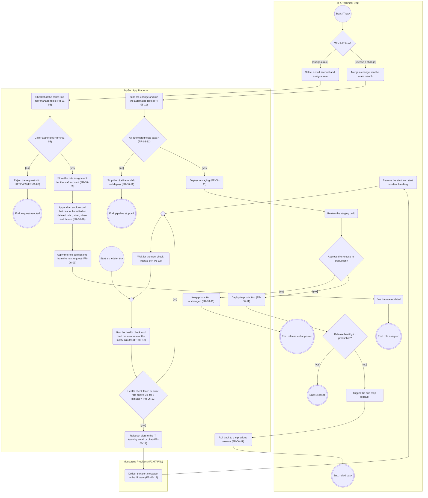

# AD-UC-10 — Manage & Maintain System Infrastructure (Quản trị hạ tầng IT & Health Monitoring)

| Thuộc tính | Giá trị |
|---|---|
| Use case | UC-10 — Manage & Maintain System Infrastructure (Quản trị hạ tầng IT & Health Monitoring) |
| Feature | F-06 Admin Operations & Analytics |
| Người phụ trách | Lê Thành Hiệp (MSSV 2411560014) |
| FR trong phạm vi | FR-06-09, FR-06-10, FR-06-11, FR-06-12 (+ FR-01-08 như cổng kiểm quyền) |
| Nguồn dữ liệu | `Group_F_Function_List___Cost_DBIZ2.xlsx` — sheets *Scope*, *FunctionList*, *Prioritization* (Initial & Effective priority) |
| Sequence trong Excel | Excel chưa có sequence riêng cho UC-10 (FR-06-09…12 chỉ ghi `UC:UC-10`) |
| Trạng thái | Bước 1–5 hoàn tất bản nháp · Peer Review: chờ nhóm bạn (xem Mục 7) |

---

## Mục 1 — Sơ đồ Activity (Bước 1 & 2)

### 1.1 Làn sử dụng (Bước 1)

| Làn (đúng tên chuẩn) | Loại làn | Vai trò trong UC | Số nút |
|---|---|---|---|
| IT & Technical Dept | Tác nhân | IT Admin gán vai trò, duyệt release, rollback; IT team nhận cảnh báo | 14 |
| MySen App Platform | Hệ thống của bạn | Kiểm quyền, lưu vai trò, ghi audit, chạy CI/CD, giám sát sức khỏe | 22 |
| Messaging Providers (FCM/APNs) | Hệ thống bên ngoài | Kênh email/chat chuyển cảnh báo cho IT team (FR-06-12) — xem A-01 | 1 |

Không dùng: Visitor / GenZ Customer, Marketing & Sales Dept, Google Identity, Partner, Staff & Admin, Indie Artists, Payment Gateway, GPS Service, F&B Partner POS. Không có làn kỹ thuật (Backend/Frontend/Database/Web App).

### 1.2 Mã Mermaid (Bước 2)



**Chú giải ký hiệu:** `st((…))` = Start · `en(((…)))` = End · `s1("…")` = hành động · `d1{"…"}` = quyết định (mỗi cạnh ra có guard) ·
`m1{" "}` = merge (nút hợp nhất, đích của mọi vòng lặp lùi). Mỗi `subgraph` là một làn. Mermaid không có swimlane thật nên khung làn có thể chồng lên nhau khi render — đây là hạn chế hiển thị, không phải lỗi cú pháp.

---

## Mục 2 — Node Trace Table (Bước 3)

### 2.1 Bảng vết: nút → FR (Excel, sheet *FunctionList*)

| Node ID | Làn | Loại | Nhãn trên sơ đồ | FR ID | Tên FR (sheet FunctionList) | L3 liên quan | Priority (Initial → Effective) | Ghi chú |
|---|---|---|---|---|---|---|---|---|
| st1 | IT & Technical Dept | Start | Start: IT task | — | — | — | — | Nút điều khiển – điểm bắt đầu, không phải hành động |
| d1 | IT & Technical Dept | Decision | Which IT task? | FR-06-09<br>FR-06-11 | Manage staff roles and permissions<br>Deploy automatically through a CI/CD pipeline | — | Must<br>Must | Quyết định của tác nhân |
| i1 | IT & Technical Dept | Action | Select a staff account and assign a role | FR-06-09 | Manage staff roles and permissions | FR-06-09-FE | Must | Hành động của tác nhân – ánh xạ tới FR mà nó kích hoạt |
| i2 | IT & Technical Dept | Action | See the role updated | FR-06-09 | Manage staff roles and permissions | FR-06-09-FE | Must | Hành động của tác nhân – ánh xạ tới FR mà nó kích hoạt |
| i3 | IT & Technical Dept | Action | Merge a change into the main branch | FR-06-11 | Deploy automatically through a CI/CD pipeline | FR-06-11-INT | Must | Hành động của tác nhân – ánh xạ tới FR mà nó kích hoạt |
| i4 | IT & Technical Dept | Action | Review the staging build | FR-06-11 | Deploy automatically through a CI/CD pipeline | FR-06-11-INT | Must | Hành động của tác nhân – ánh xạ tới FR mà nó kích hoạt |
| d4 | IT & Technical Dept | Decision | Approve the release to production? | FR-06-11 | Deploy automatically through a CI/CD pipeline | FR-06-11-INT | Must | Hành động của tác nhân – ánh xạ tới FR mà nó kích hoạt |
| d5 | IT & Technical Dept | Decision | Release healthy in production? | FR-06-11 | Deploy automatically through a CI/CD pipeline | FR-06-11-INT | Must | Hành động của tác nhân – ánh xạ tới FR mà nó kích hoạt |
| i5 | IT & Technical Dept | Action | Trigger the one-step rollback | FR-06-11 | Deploy automatically through a CI/CD pipeline | FR-06-11-INT | Must | Hành động của tác nhân – ánh xạ tới FR mà nó kích hoạt |
| i6 | IT & Technical Dept | Action | Receive the alert and start incident handling | FR-06-12 | Monitor servers and alert on failure | FR-06-12-INT | Should | Hành động của tác nhân – ánh xạ tới FR mà nó kích hoạt |
| en1 | IT & Technical Dept | End | End: role assigned | — | — | — | — | Nút điều khiển – điểm kết thúc, không phải hành động |
| en3 | IT & Technical Dept | End | End: release not approved | — | — | — | — | Nút điều khiển – điểm kết thúc, không phải hành động |
| en4 | IT & Technical Dept | End | End: released | — | — | — | — | Nút điều khiển – điểm kết thúc, không phải hành động |
| en5 | IT & Technical Dept | End | End: rolled back | — | — | — | — | Nút điều khiển – điểm kết thúc, không phải hành động |
| s1 | MySen App Platform | Action | Check that the caller role may manage roles (FR-01-08) | FR-01-08 | Enforce basic role-based access control | FR-01-08-BE | Must |  |
| d2 | MySen App Platform | Decision | Caller authorised? (FR-01-08) | FR-01-08 | Enforce basic role-based access control | FR-01-08-BE | Must |  |
| s2 | MySen App Platform | Action | Reject the request with HTTP 403 (FR-01-08) | FR-01-08 | Enforce basic role-based access control | FR-01-08-BE | Must |  |
| s3 | MySen App Platform | Action | Store the role assignment for the staff account (FR-06-09) | FR-06-09 | Manage staff roles and permissions | FR-06-09-BE | Must |  |
| s4 | MySen App Platform | Action | Append an audit record that cannot be edited or deleted: who, what, when and device (FR-06-10) | FR-06-10 | Record an audit log of admin actions | FR-06-10-BE | Must | Append-only; log viewer thuộc Won't-have (Scope bảng 3) |
| s5 | MySen App Platform | Action | Apply the role permissions from the next request (FR-06-09) | FR-06-09 | Manage staff roles and permissions | FR-06-09-BE | Must | Cấp quyền cho FR-01-08 kiểm tra |
| en6 | MySen App Platform | End | End: request rejected | — | — | — | — | Nút điều khiển – điểm kết thúc, không phải hành động |
| s6 | MySen App Platform | Action | Build the change and run the automated tests (FR-06-11) | FR-06-11 | Deploy automatically through a CI/CD pipeline | FR-06-11-INT | Must |  |
| d3 | MySen App Platform | Decision | All automated tests pass? (FR-06-11) | FR-06-11 | Deploy automatically through a CI/CD pipeline | FR-06-11-INT | Must |  |
| s7 | MySen App Platform | Action | Stop the pipeline and do not deploy (FR-06-11) | FR-06-11 | Deploy automatically through a CI/CD pipeline | FR-06-11-INT | Must |  |
| s8 | MySen App Platform | Action | Deploy to staging (FR-06-11) | FR-06-11 | Deploy automatically through a CI/CD pipeline | FR-06-11-INT | Must |  |
| s9 | MySen App Platform | Action | Keep production unchanged (FR-06-11) | FR-06-11 | Deploy automatically through a CI/CD pipeline | FR-06-11-INT | Must |  |
| s10 | MySen App Platform | Action | Deploy to production (FR-06-11) | FR-06-11 | Deploy automatically through a CI/CD pipeline | FR-06-11-INT | Must |  |
| s11 | MySen App Platform | Action | Roll back to the previous release (FR-06-11) | FR-06-11 | Deploy automatically through a CI/CD pipeline | FR-06-11-INT | Must |  |
| en2 | MySen App Platform | End | End: pipeline stopped | — | — | — | — | Nút điều khiển – điểm kết thúc, không phải hành động |
| st2 | MySen App Platform | Start | Start: scheduler tick | — | — | — | — | Nút điều khiển – điểm bắt đầu, không phải hành động |
| m1 | MySen App Platform | Merge | (trống) | — | — | — | — | Nút điều khiển – hợp nhất luồng / đích của vòng lặp lùi |
| s12 | MySen App Platform | Action | Run the health check and read the error rate of the last 5 minutes (FR-06-12) | FR-06-12 | Monitor servers and alert on failure | FR-06-12-INT | Should |  |
| d6 | MySen App Platform | Decision | Health check failed or error rate above 5% for 5 minutes? (FR-06-12) | FR-06-12 | Monitor servers and alert on failure | FR-06-12-INT | Should |  |
| s13 | MySen App Platform | Action | Raise an alert to the IT team by email or chat (FR-06-12) | FR-06-12 | Monitor servers and alert on failure | FR-06-12-INT | Should |  |
| m2 | MySen App Platform | Merge | (trống) | — | — | — | — | Nút điều khiển – hợp nhất luồng / đích của vòng lặp lùi |
| s14 | MySen App Platform | Action | Wait for the next check interval (FR-06-12) | FR-06-12 | Monitor servers and alert on failure | FR-06-12-INT | Should |  |
| p1 | Messaging Providers (FCM/APNs) | Action | Deliver the alert message to the IT team (FR-06-12) | FR-06-12 | Monitor servers and alert on failure | FR-06-12-INT | Should | Email/chat (xem Mục 4, A-01) |

### 2.2 Ma trận phủ FR

| FR ID | Tên FR | Priority | Nút hệ thống / bên ngoài (có FR trong nhãn) | Nút tác nhân liên quan | Ghi chú |
|---|---|---|---|---|---|
| FR-06-09 | Manage staff roles and permissions | Must | s3, s5 | d1, i1, i2 |  |
| FR-06-10 | Record an audit log of admin actions | Must | s4 | — |  |
| FR-06-11 | Deploy automatically through a CI/CD pipeline | Must | s6, d3, s7, s8, s9, s10, s11 | d1, i3, i4, d4, d5, i5 |  |
| FR-06-12 | Monitor servers and alert on failure | Should | s12, d6, s13, s14, p1 | i6 |  |
| FR-01-08 | Enforce basic role-based access control | Must | s1, d2, s2 | — | Thuộc F-01; vẽ ở đây vì là cổng kiểm quyền trước khi đổi vai trò (s1, d2, s2) |

---

## Mục 3 — Branch Tests (Bước 4)

| Test ID | Nút | Guard | Luồng đi qua | Given | When | Then | FR |
|---|---|---|---|---|---|---|---|
| BT-10-01 | d1 | [assign a role] | d1→i1→s1 | Admin IT đăng nhập hệ thống quản trị | chọn "Phân quyền nhân sự" | Hiển thị danh sách nhân sự để chọn tài khoản và vai trò | FR-06-09 |
| BT-10-02 | d1 | [release a change] | d1→i3→s6 | Lập trình viên hoàn tất pull request #142 | merge #142 vào nhánh main | Pipeline CI/CD tự khởi chạy: build và chạy kiểm thử tự động | FR-06-11 |
| BT-10-03 | d2 | [no] | d2→s2→en6 | Tài khoản mkt.huong có vai trò Marketing (không được quản lý vai trò) | gọi API gán vai trò "IT Admin" cho chính mình | Hệ thống trả HTTP 403, vai trò không thay đổi, không có bản ghi vai trò mới | FR-01-08 |
| BT-10-04 | d2 | [yes] | d2→s3→s4→s5→i2→en1 | Tài khoản it.admin có vai trò IT Administrator | gán vai trò "Marketing Manager" cho nhân viên mkt.huong | Qua kiểm quyền; vai trò được lưu, 1 bản audit được thêm, quyền mới có hiệu lực từ request kế tiếp, IT Admin thấy vai trò đã cập nhật | FR-01-08, FR-06-09, FR-06-10 |
| BT-10-05 | d3 | [no] | d3→s7→en2 | PR #142 có 2 bài kiểm thử tự động thất bại | pipeline chạy xong giai đoạn test | Pipeline dừng, KHÔNG deploy lên staging, production không đổi | FR-06-11 |
| BT-10-06 | d3 | [yes] | d3→s8→i4 | PR #142 pass toàn bộ kiểm thử tự động | pipeline chạy xong giai đoạn test | Bản build được deploy lên staging để IT xem xét | FR-06-11 |
| BT-10-07 | d4 | [no] | d4→s9→en3 | Bản trên staging chạy được nhưng IT phát hiện thiếu tính năng cần có | IT chọn "Từ chối release" | Production giữ nguyên bản hiện tại, không deploy | FR-06-11 |
| BT-10-08 | d4 | [yes] | d4→s10→d5 | Bản trên staging đã được IT kiểm tra đạt | IT chọn "Duyệt release" | Hệ thống deploy lên production | FR-06-11 |
| BT-10-09 | d5 | [yes] | d5→en4 | Vừa deploy production; trang đăng nhập và Home hoạt động, tỉ lệ lỗi dưới 1% | IT kiểm tra sau deploy | Release được giữ, kết thúc luồng | FR-06-11 |
| BT-10-10 | d5 | [no] | d5→i5→s11→en5 | Vừa deploy production; endpoint đăng nhập trả lỗi 500 hàng loạt | IT bấm rollback một bước | Hệ thống quay về bản release trước đó và kết thúc luồng | FR-06-11 |
| BT-10-11 | d6 | [yes] | d6→s13→p1→i6→m2 | Tỉ lệ lỗi server 7% suốt 5 phút liên tục (hoặc health check /health trả 503) | tới chu kỳ kiểm tra của scheduler | Hệ thống gửi cảnh báo qua email/chat tới IT team; IT nhận và bắt đầu xử lý sự cố | FR-06-12 |
| BT-10-12 | d6 | [no] | d6→m2→s14→m1 | Tỉ lệ lỗi 4,9% (dưới ngưỡng) hoặc mới vượt 5% được 3 phút | tới chu kỳ kiểm tra của scheduler | Không gửi cảnh báo; hệ thống chờ chu kỳ kiểm tra tiếp theo | FR-06-12 |

**Kiểm thử bổ sung cho nút đặc biệt (không phải nhánh rẽ):**

| Test ID | Nút | Guard | Luồng đi qua | Given | When | Then | FR |
|---|---|---|---|---|---|---|---|
| NT-10-01 | s4 | Kiểm tra nút | s4 | Đã có bản audit "it.admin gán vai trò Marketing Manager cho mkt.huong" | bất kỳ ai, kể cả it.admin, cố UPDATE hoặc DELETE bản ghi đó | Thao tác bị từ chối; bản ghi gốc không đổi; chỉ có thể THÊM bản ghi mới | FR-06-10 |

---

## Mục 4 — Giả định & phạm vi

### 4.1 Giả định

| ID | Giả định | Lý do |
|---|---|---|
| A-01 | Cảnh báo email/chat vẽ ở làn **Messaging Providers (FCM/APNs)** | Đây là làn bên ngoài duy nhất được phép cho kênh nhắn tin |
| A-02 | Việc giám sát chạy theo "scheduler tick" của hạ tầng hosting; chu kỳ chưa quy định | FR-06-12-INT: "using the hosting provider's tools" |
| A-03 | Quyết định "Release healthy?" và rollback do IT thực hiện thủ công | Excel có L3 "one-step rollback" nhưng không có điều kiện tự động |
| A-04 | Công cụ hosting và CI/CD runner không phải làn riêng; gộp vào **MySen App Platform** | Quy tắc: chỉ một làn hệ thống duy nhất |
| A-05 | Audit ở UC-10 chỉ vẽ cho thay đổi vai trò; audit cho campaign vẽ ở AD-UC-08; tham số compliance (FR-06-08) chưa có sơ đồ | FR-06-10 áp dụng cho 3 loại hành động |
| A-06 | Request bị từ chối 403 không sinh bản audit | FR-06-10 chỉ ghi create/change/delete |
| A-07 | Vai trò gán xong có hiệu lực từ request kế tiếp, nên s5 là phần "cấp" cho cổng kiểm quyền FR-01-08 | FR-06-09 và FR-06-09-BE: "feed the F-01 access check" |

### 4.2 Ngoài phạm vi (Won't-have, từ sheet *Scope* bảng 3) — không vẽ

Màn hình xem audit log (IT đọc log bằng công cụ hosting) · backup và disaster recovery (hoãn, nhưng phải quay lại trước go-live).

### 4.3 FR không có trong sơ đồ này

Không có: FR-06-09, 10, 11, 12 đều được vẽ; FR-01-08 được vẽ ở đây thay vì AD-UC-01.

---

## Mục 5 — Tự kiểm tra tự động (trước khi rà soát AI)

Kiểm tra chạy trên chính đoạn mã Mermaid ở Mục 1.2 (37 nút, 37 cạnh):

| # | Tiêu chí | Kết quả |
|---|---|---|
| L1 | Chỉ dùng làn được phép (không có Backend/Frontend/Database/Web App) | ✅ Đạt |
| L2 | Mọi hành động/quyết định của hệ thống kết thúc bằng (FR-xx-xx) | ✅ Đạt |
| L3 | Mọi mã FR tồn tại trong sheet FunctionList của Excel | ✅ Đạt |
| L4 | Mọi nút rẽ nhánh có ≥2 nhánh và mỗi nhánh có guard không rỗng và khác nhau ([yes]/[no] hoặc nhãn riêng) | ✅ Đạt |
| L5 | Chỉ nút rẽ nhánh mới có guard trên cạnh đi ra | ✅ Đạt |
| L6 | Mọi vòng lặp lùi về đều đi qua nút merge (tìm thấy 1 cạnh lùi) | ✅ Đạt |
| L7 | Mọi nút đều đi tới được từ một Start | ✅ Đạt |
| L8 | Start không có cạnh vào; End không có cạnh ra; mọi nút khác đều có lối ra | ✅ Đạt |
| L9 | Mỗi merge có ≥2 cạnh vào và đúng 1 cạnh ra | ✅ Đạt |
| L10 | Nhãn không chứa ký tự dễ làm hỏng Mermaid (" # ; < > `) | ✅ Đạt |
| L11 | Số nút = 37, số cạnh = 37, nút rẽ nhánh = 6, merge = 2 | ✅ Đạt |
| L12 | Mermaid parser (mermaid@11.4.1, flowchart) phân tích không lỗi | ✅ Đạt |

Ghi chú: nút `d1` dùng guard có tên (`[assign a role]`, `[release a change]`) vì là lựa chọn loại công việc, không phải câu hỏi có/không.

---

## Mục 6 — Rà soát AI (Bước 5)

### 6.1 Prompt Critic đã dùng

```text
Bạn là reviewer khó tính về UML Activity Diagram và phân tích nghiệp vụ.
Tôi gửi kèm: (1) mã Mermaid flowchart TD của UC-10 (Manage & Maintain System Infrastructure); (2) các dòng FR liên quan trong
Excel (FR-06-09…FR-06-12, FR-01-08) gồm tên FR và tiêu chí EARS; (3) bảng Node Trace và Branch Tests.

Quy tắc bắt buộc của sơ đồ:
- Chỉ dùng các làn: Visitor / GenZ Customer, Marketing & Sales Dept, IT & Technical Dept,
  MySen App Platform, Google Identity, Messaging Providers (FCM/APNs). KHÔNG có làn Backend/Frontend/Database/Web App.
- Mọi hành động của hệ thống kết thúc bằng mã FR trong ngoặc, ví dụ s1("Anti-cheat Validation (FR-04-02)").
- Mọi nút rẽ nhánh phải có guard rõ ràng trên từng cạnh đi ra, ví dụ |"[yes]"| và |"[no]"|.
- Mọi vòng lặp lùi về phải đi qua nút merge, ví dụ m1{" "}.

Hãy làm 3 việc, KHÔNG viết lại sơ đồ trừ khi tôi yêu cầu:
A. Lỗi cú pháp Mermaid và vi phạm 4 quy tắc trên (nêu node ID cụ thể).
B. Lỗ hổng nghiệp vụ: nhánh thiếu, trạng thái không kết thúc, vòng lặp vô hạn, deadlock, nhánh lỗi bị bỏ sót,
   lỗ hổng bảo mật, chỗ sơ đồ mâu thuẫn với tiêu chí EARS trong Excel.
C. Chỗ nào bạn phải ĐOÁN vì Excel không nói rõ — hãy liệt kê thành câu hỏi, đừng tự bịa quy tắc.
Xuất kết quả dạng bảng: # | Loại (A/B/C) | Node ID | Mô tả | Mức (Cao/TB/Thấp) | Đề xuất sửa.
```

### 6.2 Kết quả rà soát

> **Lưu ý trung thực:** lượt rà soát này do chính Claude (cùng AI đã viết sơ đồ) thực hiện nên có thể cùng "điểm mù".
> Hãy dán prompt trên cho một AI khác (hoặc model khác) và ghi thêm các dòng C-xx mới vào bảng dưới trước khi nộp.

| # | Loại | Vị trí | Phát hiện | Mức | Trạng thái |
|---|---|---|---|---|---|
| C-01 | B | s4 / FR-06-10 | Excel không nói điều gì xảy ra nếu **ghi audit thất bại**: hành động có bị hủy (fail-closed) hay vẫn thực hiện? Với log "không thể sửa đổi" đây là lỗ hổng bảo mật. | Cao | Mở — cần quyết định; chưa đưa vào sơ đồ vì Excel không quy định |
| C-02 | B | d6 → s13 | Khi lỗi kéo dài, mỗi chu kỳ đều gửi cảnh báo (không có cooldown/gộp sự cố) → dễ ngập thông báo. | TB | Mở — đề xuất thêm quy tắc chống lặp |
| C-03 | B | p1 / s13 | Chưa có nhánh khi **gửi cảnh báo thất bại** (email/chat không tới) — chính hệ thống giám sát có thể "im lặng". | TB | Mở — Excel chưa quy định |
| C-04 | C | d5, i5 | Excel có L3 "one-step rollback" nhưng EARS không nêu điều kiện rollback; sơ đồ giả định IT quyết định thủ công. | TB | Giả định A-03 |
| C-05 | C | d2 / s2 | Lần gọi bị từ chối 403 không được ghi audit (FR-06-10 chỉ ghi create/change/delete). | Thấp | Giả định A-06 — cân nhắc ghi log bảo mật riêng |
| C-06 | C | st2 / s12 | Chu kỳ chạy kiểm tra sức khỏe chưa được quy định. | Thấp | Giả định A-02 |
| C-07 | B | Phạm vi UC-10 | Backup & disaster recovery bị hoãn nhưng Scope ghi "must come back before go-live" — không có ở sơ đồ này. | TB | Ghi nhận — theo dõi ngoài sơ đồ |
| C-08 | A | p1 / lane LP | Tên làn "Messaging Providers (FCM/APNs)" là push, còn cảnh báo đi qua email/chat. | Thấp | Giả định A-01 |
| C-09 | A | Toàn bộ sơ đồ | Lint tự động L1–L12 đạt; render Chromium thành công (37 nút, 37 cạnh); có 2 điểm Start (IT khởi tạo và scheduler). | Thấp | Đã xác minh |

---

## Mục 7 — Peer Review (Bước 5)

Nhóm phản biện: **Team__ (chưa gán)** · Ngày giao: __/__/2026 · Ngày nhận lại: __/__/2026

| Hạng mục | Trạng thái |
|---|---|
| Đã chuyển thư mục cho nhóm bạn | ☐ |
| Nhận lại tệp `review-TeamXX.md` | ☐ |
| Đã xử lý từng nhận xét (ghi Accept / Reject + lý do vào cuối tệp review) | ☐ |

Mẫu tệp nhận xét: xem `review-TeamXX.template.md`.
