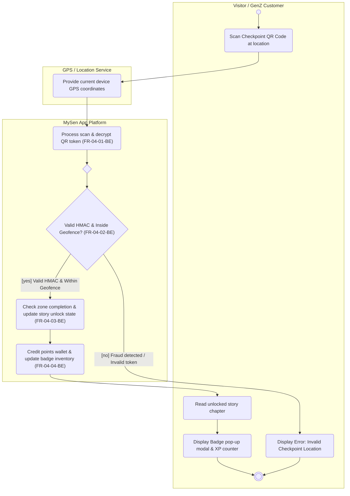

# AD-UC-04: Participate in Gamification & Challenges

## Header Table

| Attribute | Value |
| :---- | :---- |
| **Use Case ID** | UC-04 |
| **Use Case Name** | Participate in Gamification & Challenges |
| **Feature ID & Name** | F-04: Gamification & Loyalty Engine |
| **Owner** | Nguyễn Hải Long |
| **Primary Actor** | Visitor / GenZ Customer |
| **Inputs Used** | Context Diagram (GPS Service), Sequence Diagram (`SEQ:Game-01`, `SEQ:Game-02`), ADR-005 (Anti-cheat) |

---

## 1\. Mermaid Diagram

&nbsp;

---

## 2\. Node Trace Table

| Node ID | Node Label / Action | Lane | Ref (FR ID / Business Rule) |
| :---- | :---- | :---- | :---- |
| `start` | Start node (Visitor initiates scan) | Visitor / GenZ Customer | Trigger |
| `a1` | Scan Checkpoint QR Code at location | Visitor / GenZ Customer | User action (`FR-04-01-FE`) |
| `g1` | Provide current device GPS coordinates | GPS / Location Service | External Service (`INT`) |
| `s1` | Process scan & decrypt QR token | MySen App Platform | System action (`FR-04-01-BE`) |
| `m1` | Merge node (Pre-decision evaluation) | MySen App Platform | Structural Node |
| `d1` | Valid HMAC & Inside Geofence? | MySen App Platform | Decision / Rule (`FR-04-02-BE`, ADR-005) |
| `s2` | Check zone completion & update story unlock state | MySen App Platform | System action (`FR-04-03-BE`) |
| `s3` | Credit points wallet & update badge inventory | MySen App Platform | System action (`FR-04-04-BE`) |
| `a2` | Read unlocked story chapter | Visitor / GenZ Customer | User action (`FR-04-03-FE`) |
| `a3` | Display Badge pop-up modal & XP counter | Visitor / GenZ Customer | User action (`FR-04-04-FE`) |
| `a4` | Display Error: "Invalid Checkpoint Location" | Visitor / GenZ Customer | Error Handling UI |
| `stop1` | Final node (Activity completion) | Visitor / GenZ Customer | Terminal Node |

---

## 3\. Branch Tests (Given / When / Then)

### Test Case 1: Valid Scan & Verification (`[yes]` Branch)

* **Given:** Visitor is physically present within the park checkpoint geofence (e.g., Distance $\le 15\text{m}$) and scans an authentic, unexpired HMAC-signed QR code.  
* **When:** The request `POST /api/v1/checkpoint/scan` is sent to `MySen App Platform`.  
* **Then:** The anti-cheat verification succeeds (`FR-04-02-BE`), system unlocks the storyline chapter (`FR-04-03-BE`), credits $+100\text{ XP}$ points, awards the zone badge (`FR-04-04-BE`), and renders the Storybook UI and Badge modal on the Mobile App.

### Test Case 2: Out of Geofence / Fraud Attempt (`[no]` Branch)

* **Given:** Visitor is outside the geofence (e.g., GPS distance $> 50\text{m}$ or using GPS spoofing) OR scans an expired QR token image.  
* **When:** The request `POST /api/v1/checkpoint/scan` is evaluated by backend `Gamification API`.  
* **Then:** Anti-cheat validation fails (`FR-04-02-BE`), backend returns `403 Forbidden`, no points/badges are awarded, and mobile app displays error *"Invalid Checkpoint Location"*.

---

## 4\. Object States Used

* `QR Token [Decrypted]`  
* `Geofence Status [Verified]`  
* `Story Progress [Unlocked]`  
* `Points Wallet [Credited]`  
* `Badge Inventory [Awarded]`

*(Note: These states are added to the State Index Table in `docs/activity/activity-index.md`)*.

---

## 5\. Verification Log & FR Coverage

* **FR Coverage Count:** $4textof4$ FRs covered (`FR-04-01`, `FR-04-02`, `FR-04-03`, `FR-04-04`).  
* **Critic Prompt Audit Result:** Passed $100\%$.  
  * All decisions have explicit guards (`[yes]`, `[no]`).  
  * System lane strictly named `MySen App Platform` (no internal architecture leakage like Backend/DB).  
  * All external entities match the Context Diagram (`GPS / Location Service`).
