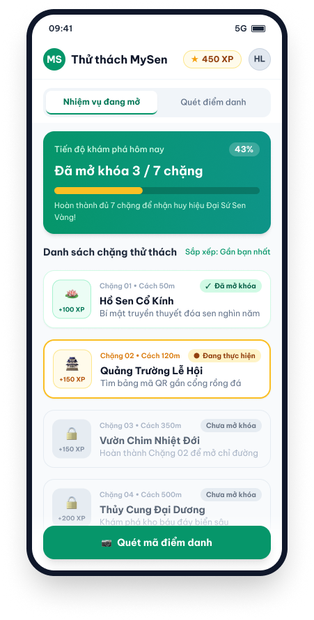

[screen_spec_s_f04_01.md](https://github.com/user-attachments/files/34536525/screen_spec_s_f04_01.md)
# Screen Spec: S-F04-01 Quest Hub & QR Scanner

| Field | Value |
|---|---|
| Screen ID | `S-F04-01` |
| Screen name | Quest Hub & QR Scanner |
| Actor | Visitor / GenZ Customer |
| Priority | Must |
| Feature | `F-04 Gamification & Interactive Park Challenges` |
| Activity diagrams | `AD-UC-04.md` |
| Mockup image | `img/S-F04-01.png` |
| Owner | Nguyễn Hải Long |
| Status | Complete Specification |

Document Owner: Nguyễn Hải Long | Last Updated: 2026-10-16

---

## 1. Purpose

**Shown when:** The visitor opens the Gamification tab from the main navigation to view active park quests, unlocked badges, and progression, or taps the central QR scanner button to scan a physical checkpoint QR code located inside Dam Sen Park.

**The user leaves this screen when:** The visitor scans a valid physical checkpoint QR code (navigates to `S-F04-02 Storybook Reader`), taps a quest card for preview, or switches to another tab (e.g., Rewards `S-F04-03` or Interactive Map `S-F03-01`).

**Source trace:** `AD-UC-04.md` nodes `a1` (open quest hub), `a2` (trigger QR scanner), `s1` (fetch quest status), `s2` (validate checkpoint QR token), `d1` (QR token validation decision), `s3` (fetch chapter lore).

---

## 2. Mockup

### Layout Overview
- **Top Navigation Bar:** Title "MySen Park Quests" | Total XP Counter badge (e.g., "450 XP") | User Profile Avatar.
- **Segment Control:** `[ Active Quests (Tab 1) | Scan Checkpoint (Tab 2) ]`
- **Tab 1 - Quest List Area:** Visual progress bar (e.g., "3 of 7 Checkpoints Cleared"), scrollable list of park zone quest cards showing checkpoint thumbnail, zone name, unlock status (Locked / Unlocked / In Progress), and earned badge icon.
- **Tab 2 - Camera Viewport:** Live camera preview with centered square targeting frame, flash toggle button, and fallback "Enter Code Manually" text link.
- **Bottom Fixed Action:** Floating action button "Scan Checkpoint QR" (activates camera mode directly).

---

## 3. Element Inventory

| # | Element | Type | Content / Data Source | Required | Validation / Rule |
|---|---|---|---|---|---|
| 1 | `QuestHeader` | Header | Static "MySen Park Quests" + Back button | Yes | Returns to Main Menu / Home screen |
| 2 | `XpCounterBadge` | Badge | User profile `user.total_xp`, format `[N] XP` | Yes | Non-negative integer; updates in real-time upon quest completion |
| 3 | `ProfileAvatar` | Image / Button | `user.avatar_url` | No | Tapping opens Profile screen (`S-F01-01`) |
| 4 | `SegmentSwitch` | Tab Toggle | "Active Quests" \| "Scan Checkpoint" | Yes | Toggles between quest list view and active camera scanner view |
| 5 | `QuestProgressBar` | Progress Bar | `user.completed_checkpoints` vs `total_checkpoints` | Yes | Shows percentage and text e.g., "3 of 7 Cleared" |
| 6 | `QuestCardList` | Scrollable List | Active park quests array `quests[]` | Yes (Tab 1) | Sorted by GPS proximity if location permitted, else by story chapter sequence |
| 7 | `QuestZoneName` | Text | `quest.zone_name` | Yes | Display text string |
| 8 | `QuestStatusBadge` | Badge | `quest.status`: "Locked", "In Progress", "Completed" | Yes | Text + distinct icon; not color alone |
| 9 | `CameraViewfinder` | Video Overlay | Hardware camera stream | Yes (Tab 2) | Requires camera permission; auto-detects 2D QR payloads within framing box |
| 10 | `FlashToggle` | IconButton | Torch icon | No | Toggles device flashlight LED if supported by hardware |
| 11 | `ManualCodeLink` | Button / Text Link | "Enter Checkpoint Code" | Yes | Opens manual 6-character code input modal |
| 12 | `ScanQrFab` | Floating Button | "Scan Checkpoint QR" | Yes | Switches directly to Tab 2 and initializes camera stream |
| 13 | `QuestDetailBottomSheet` | Bottom Sheet | Selected quest metadata, zone hint, teaser text | No | Opened when tapping a `QuestCard` |
| 14 | `ManualCodeDialog` | Modal | Text input field for 6-character code + "Verify Code" button | No | Input format: 6 alphanumeric uppercase characters |
| 15 | `PermissionBanner` | Banner | "Camera access required to scan physical checkpoint QR codes." | No | Displayed when camera permission is denied |

---

## 4. States

| State | What the user sees | Trigger |
|---|---|---|
| Default | Tab 1 active with total XP counter, overall quest progress bar, and list of park quest cards with current unlock statuses. | Screen opens after user taps Quests tab |
| Camera Active | Tab 2 active: live full-screen camera stream with centered square reticle, flashlight toggle, and manual code link. | User taps "Scan Checkpoint" segment or Floating Action Button |
| Empty (no data) | Banner: "No active park quests found. Please check back during park operating hours!" | Backend returns empty quest list |
| Loading | Skeleton cards for quest list; animated scanning spinner over camera viewfinder during QR payload verification. | Data loading on initial open or processing scanned QR token |
| Error | Camera denied: PermissionBanner with "Open Settings" button. Invalid QR: Toast "Invalid checkpoint QR code. Make sure you are at a Dam Sen Park location!" Out-of-bounds: Toast "GPS location verification failed. You must be physically near the checkpoint." | Permission rejection, invalid QR signature, or geo-fencing check failure |
| Success / confirmation | Haptic vibration feedback, scanning reticle flashes green, and screen immediately transitions to `S-F04-02 Storybook Reader`. | Server returns 200 OK for POST `/api/v1/quests/scan` |

---

## 5. User Interaction & Events

| # | Element | User Action | System Response | Goes to Screen |
|---|---|---|---|---|
| 1 | Screen | Open Quests tab | Fetches user quest progression (GET `/api/v1/quests/progress`); renders XP counter and quest cards. | stays |
| 2 | `SegmentSwitch` | Tap "Scan Checkpoint" | Checks camera permission. If granted, starts video stream; if denied, displays `PermissionBanner`. | stays |
| 3 | `CameraViewfinder` | Frame valid checkpoint QR | Decodes QR token; sends POST `/api/v1/quests/scan` with payload `{qr_token, latitude, longitude}`. | stays |
| 4 | Scanner validation | Token & GPS valid (200 OK) | Saves scan result in session cache and opens Storybook Reader with chapter payload. | `S-F04-02` |
| 5 | Scanner validation | Token invalid / already scanned | Displays Toast: "Invalid QR" or "Checkpoint already scanned today". Keeps camera stream active. | stays |
| 6 | `ManualCodeLink` | Tap "Enter Checkpoint Code" | Opens `ManualCodeDialog` overlay. | stays (modal) |
| 7 | `ManualCodeDialog` | Enter code & tap "Verify" | Sends POST `/api/v1/quests/verify-code` with `{checkpoint_code}`. On success: closes modal and navigates to `S-F04-02`. | `S-F04-02` (on success) |
| 8 | `QuestCardList` | Tap a Quest Card | Opens `QuestDetailBottomSheet` with zone teaser, story lore snippet, and map hint. | stays |
| 9 | `QuestHeader` | Tap Back | Stops camera stream (if active) and returns to Main Menu. | Main Menu / Home |

---

## 6. Screen-Level Rules

| Rule ID | Rule | Source |
|---|---|---|
| SR-F04-01-01 | Only signed-in visitors can access quest progression and scan checkpoint codes. Unauthenticated users are redirected to `S-F00-01`. | `AD-UC-04` Precondition |
| SR-F04-01-02 | QR code scanning requires both a valid rotating HMAC QR payload and GPS coordinates within 50 meters of the physical checkpoint. | `FR-04-01`, `FR-04-02` |
| SR-F04-01-03 | A checkpoint can only be scanned and completed once per visitor per calendar day (resets at 00:00 Asia/Ho_Chi_Minh). | `FR-04-01` |
| SR-F04-01-04 | If hardware camera stream is unavailable or permission is denied, a manual 6-character code fallback option must always be provided. | Accessibility & UX Rule |
| SR-F04-01-05 | XP counters and progress ratios must always reflect server-validated values, never calculated locally on client devices. | Data Integrity Rule |

---

## 7. Linked Requirements

| FR ID | Priority | What This Screen Does For It |
|---|---|---|
| `FR-04-01` | Must | Displays active park quests, completed checkpoint progress, total XP earned, and handles QR code scanning logic. |
| `FR-04-02` | Must | Provides geo-location validation and manual code verification fallback for physical park checkpoints. |

---

## 8. Responsive & Accessibility Notes

- **Responsive Adaptations:**
  - *Mobile (iOS / Android):* Full-screen camera viewport overlay with haptic vibration upon successful QR code detection. Floating action button fixed at bottom-right.
  - *Tablet / Desktop Web:* Split-screen layout — Quest progress list on the left column (60% width), camera preview or manual entry code container on the right column (40% width).
- **Accessibility (WCAG 2.2):**
  - High-contrast toggle available for outdoor sunlight visibility.
  - Text-to-speech audio prompts when a QR code is recognized ("QR Code Scanned Successfully").
  - All touch targets (flash toggle, manual code link, quest cards) maintain a minimum size of 48×48 dp.

---

## 9. Open Questions

| # | Question | Blocking? | Default Applied |
|---|---|---|---|
| 1 | What is the maximum allowed GPS distance tolerance for physical QR scanning if dense tree canopy degrades GPS accuracy? | No | 50 meters radius enforced |
| 2 | Does scanning a checkpoint QR while offline store the scan payload locally for auto-syncing upon reconnection? | No | Saved locally in IndexedDB / AsyncStorage; synced on network restoration |
