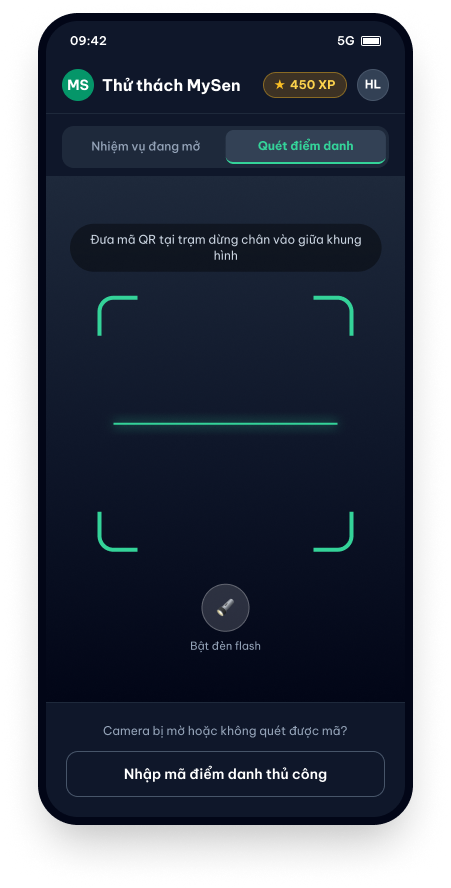

[screen_spec_s_f04_02.md](https://github.com/user-attachments/files/34536551/screen_spec_s_f04_02.md)
# Screen Spec: S-F04-02 Storybook Reader & Badge Reward

| Field | Value |
|---|---|
| Screen ID | `S-F04-02` |
| Screen name | Storybook Reader & Badge Reward |
| Actor | Visitor / GenZ Customer |
| Priority | Must |
| Feature | `F-04 Gamification & Interactive Park Challenges` |
| Activity diagrams | `AD-UC-04.md` |
| Mockup image | `img/S-F04-02.png` |
| Owner | Nguyễn Hải Long |
| Status | Complete Specification |

Document Owner: Nguyễn Hải Long | Last Updated: 2026-10-16

---

## 1. Purpose

**Shown when:** Displayed immediately after a visitor successfully scans a valid physical checkpoint QR code (or inputs a valid manual code) on `S-F04-01`. Presents interactive park lore, storybook chapters, awards XP, and triggers badge unlock celebration overlays.

**The user leaves this screen when:** The visitor taps "Continue Quest" to return to `S-F04-01 Quest Hub` (with the next zone highlighted), taps "View Map" to navigate to `S-F03-01 Interactive Map`, or opens the native Social Share sheet.

**Source trace:** `AD-UC-04.md` nodes `s3` (fetch chapter content), `s4` (award XP and unlock zone badge), `m1` (trigger Badge Unlocked Modal `M-F04-01`), `a3` (interactive trivia choice), `s5` (record story completion).

---

## 2. Mockup

### Layout Overview
- **Top Navigation Bar:** Back Button | Chapter Title (e.g., "Chapter 3: The Ancient Lotus") | Share Icon.
- **Hero Header Area:** High-resolution artwork / animated illustration of the park zone with integrated audio narration player control bar (Play / Pause / Progress bar).
- **Main Reading Canvas:** Rich text story narrative with custom typography, embedded interactive trivia quiz choice widget (e.g., "Which dynasty built this pagoda?"), and instant feedback indicator.
- **Reward Summary Card:** Unlocked Badge graphic, "+100 XP Earned" particle animation banner, and "Collect Reward" trigger.
- **Bottom Sticky Navigation Bar:** Secondary Button "Share Achievement" | Primary Button "Continue Quest & View Map".
- **Overlay:** `M-F04-01 Badge Unlocked Modal`.

---

## 3. Element Inventory

| # | Element | Type | Content / Data Source | Required | Validation / Rule |
|---|---|---|---|---|---|
| 1 | `StoryHeader` | Header | Back button + Chapter Title `chapter.title` + Share icon | Yes | Back button returns to `S-F04-01` |
| 2 | `HeroArtwork` | Image / Animation | `chapter.image_url` (WebP format / Lottie animation) | Yes | Optimized loading; alt text provided for screen readers |
| 3 | `AudioPlayerBar` | Media Control | Stream URL `chapter.audio_url` | No | Play/Pause toggle, duration slider; auto-pauses when screen loses focus |
| 4 | `StoryCanvas` | Rich Text | `chapter.story_html` / Markdown content | Yes | Supports font size toggle (Small / Medium / Large) |
| 5 | `TriviaQuizWidget` | Radio Group | `chapter.trivia_question` + 4 multiple choice options | No | Optional bonus activity. Correct answer grants +20 bonus XP |
| 6 | `TriviaSubmitButton` | Secondary Button | "Submit Answer" | No | Disabled until one radio option is selected; single attempt allowed |
| 7 | `RewardSummaryCard` | Card | Badge icon `badge.icon_url` + "+100 XP Earned" banner | Yes | Highlighted container showing earned rewards for this checkpoint |
| 8 | `ShareButton` | Secondary Button | "Share Achievement" | Yes | Invokes native OS share sheet with custom generated achievement card |
| 9 | `ContinueQuestButton` | Primary Button | "Continue Quest & View Map" | Yes | Saves chapter reading progress and returns to `S-F04-01` |
| 10 | `BadgeModal` (`M-F04-01`) | Modal Overlay | "Badge Unlocked!", badge graphic, animation, "Awesome!" button | Yes | Triggers automatically 1 second after initial screen render for newly unlocked badges |

---

## 4. States

| State | What the user sees | Trigger |
|---|---|---|
| Default | Storybook chapter content rendered, hero image visible, audio player ready, reward summary card showing +100 XP earned. | Navigated from successful QR scan on `S-F04-01` |
| Modal Active | `M-F04-01 Badge Unlocked Modal` overlay active over blurred story background with confetti particle animation. | 1 second after screen load for newly unlocked zone badges |
| Loading | Skeleton text lines and placeholder hero image shimmer effect while story content loads. | Initial API request GET `/api/v1/chapters/{id}` in progress |
| Error | Audio stream failure: Toast "Audio narration currently unavailable. Enjoy reading the story text below!" Chapter load failure: Banner "Unable to load story chapter. Tap to retry." | Network timeout or CDN audio file streaming error |
| Success / Confirmation | Trivia answered correctly: Quiz widget turns green with "+20 Bonus XP" animation. Share tapped: Native share sheet opens successfully. | Submitting correct trivia answer or tapping "Share Achievement" |

---

## 5. User Interaction & Events

| # | Element | User Action | System Response | Goes to Screen |
|---|---|---|---|---|
| 1 | Screen Load | Arrive from `S-F04-01` | Fetches chapter lore (GET `/api/v1/chapters/{id}`); evaluates badge status. If new badge unlocked, triggers `M-F04-01` modal after 1s delay. | stays |
| 2 | `M-F04-01` Modal | Tap "Awesome!" | Closes modal overlay with sound effect; returns focus to main reading canvas. | stays |
| 3 | `AudioPlayerBar` | Tap Play button | Streams chapter narration audio file; button state updates to Pause. | stays |
| 4 | `TriviaQuizWidget` | Select option & tap "Submit" | Sends POST `/api/v1/quests/trivia` with `{chapter_id, selected_option_id}`. Correct: displays green feedback & +20 XP. Incorrect: displays red feedback & correct answer explanation. | stays |
| 5 | `ShareButton` | Tap "Share Achievement" | Generates dynamic image card with user name, badge graphic, and QR code link; opens OS native share sheet. | stays |
| 6 | `ContinueQuestButton` | Tap "Continue Quest" | Saves chapter reading state to user profile; updates quest progression cache. | `S-F04-01` (or `S-F03-01`) |
| 7 | `StoryHeader` | Tap Back button | Returns to Quest Hub screen without losing earned XP/badge status. | `S-F04-01` |

---

## 6. Screen-Level Rules

| Rule ID | Rule | Source |
|---|---|---|
| SR-F04-02-01 | Storybook chapters can only be unlocked through a verified scan payload or valid manual checkpoint code passed from `S-F04-01`. Direct deep-linking without validation is prohibited. | `FR-04-03`, Security Rule |
| SR-F04-02-02 | Badge unlocks (`M-F04-01`) and +100 XP rewards are awarded exactly once per unique checkpoint. Re-reading an already unlocked chapter displays story lore but awards 0 additional base XP. | `FR-04-04` |
| SR-F04-02-03 | Audio narration streaming must automatically pause if the user backgrounds the application, receives an incoming phone call, or navigates away. | Media Playback Rule |
| SR-F04-02-04 | The interactive trivia quiz is optional; failure to answer or an incorrect answer does not revoke the base +100 XP or zone badge already awarded for scanning. | `FR-04-03` |

---

## 7. Linked Requirements

| FR ID | Priority | What This Screen Does For It |
|---|---|---|
| `FR-04-03` | Must | Displays interactive park lore, rich-text storybook chapters, multimedia audio narration, and optional trivia quizzes. |
| `FR-04-04` | Must | Triggers zone achievement badge unlocks, displays reward summaries, particle celebration animations (`M-F04-01`), and social sharing. |

---

## 8. Responsive & Accessibility Notes

- **Responsive Adaptations:**
  - *Mobile (iOS / Android):* Single-column continuous vertical scrolling layout with sticky bottom action navigation bar.
  - *Tablet / Desktop Web:* Centered reading canvas capped at a maximum width of 720px, with a floating right-hand sidebar showing the unlocked badge gallery and next checkpoint mini-map preview.
- **Accessibility (WCAG 2.2):**
  - Full Screen Reader (TalkBack / VoiceOver) compatibility for story narrative text and custom audio player controls.
  - Dynamic font size adjustment support (scalable up to 200% without clipping or layout breakdown).
  - All images include meaningful descriptive `alt` text tags.

---

## 9. Open Questions

| # | Question | Blocking? | Default Applied |
|---|---|---|---|
| 1 | Are storybook chapter audio narration files downloadable for offline listening within the park? | No | Audio streams online via CDN by default |
| 2 | Can users re-attempt a missed trivia question on subsequent days to claim the +20 bonus XP? | No | Single attempt per checkpoint scan per day |
