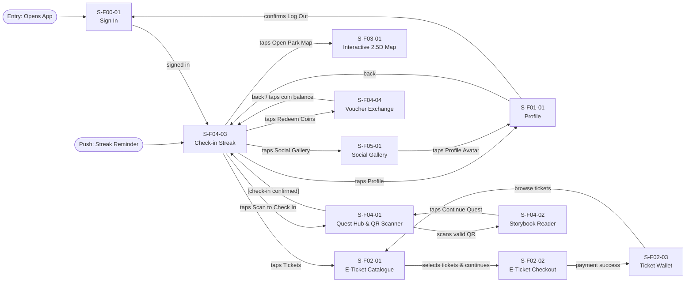
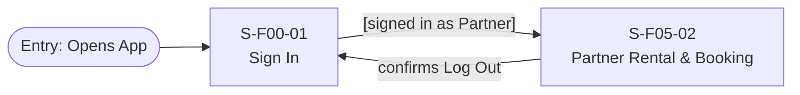
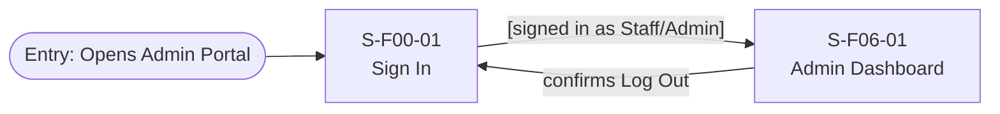

# Screen Transition Diagram: MySen Platform

## 1. Visitor / GenZ Customer Flow

---

## 2. Partner / Commercial Flow

---

## 3. Staff & Admin Flow

---

## 4. Transition Mapping Table

| Source Screen | Trigger / User Action | Target Screen |
|---|---|---|
| `S-F00-01` | Sign in succeeds (Role-based) | `S-F04-03` (Visitor) / `S-F06-01` (Staff) |
| `S-F04-03` | Taps Tickets tab | `S-F02-01` (E-Ticket Catalogue) |
| `S-F02-01` | Selects ticket quantity & taps Continue | `S-F02-02` (E-Ticket Checkout) |
| `S-F02-02` | Verified payment success | `S-F02-03` (Ticket Wallet) |
| `S-F04-03` | Taps "Scan to Check In" | `S-F04-01` (Quest Hub & QR Scanner) |
| `S-F04-01` | Scans valid checkpoint QR | `S-F04-02` (Storybook Reader) |
| `S-F04-03` | Taps "Redeem Coins" | `S-F04-04` (Voucher Exchange) |
| `S-F04-03` | Taps "Open Park Map" | `S-F03-01` (Interactive 2.5D Map) |
| `S-F04-03` | Taps Social Gallery tab | `S-F05-01` (Social Feed) |
| `S-F00-01` | Sign in as Partner | `S-F05-02` (Partner Rental & Booking) |
