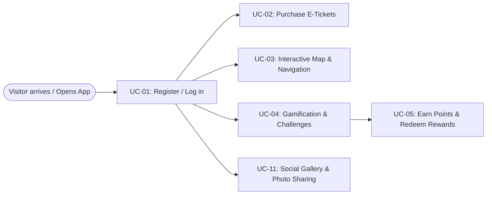
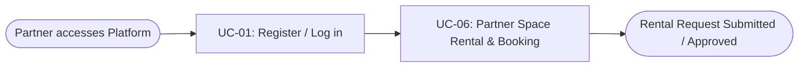
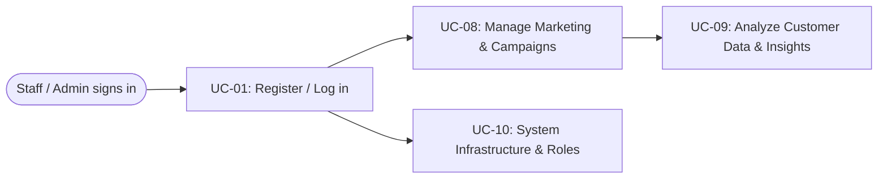

# Usage Flow: MySen Platform

## 1. Visitor / Customer Flow

| Step | Use Case | Activity Diagram | Screens Served | Owner |
|---|---|---|---|---|
| Step 1 | UC-01: Register / Log in | AD-UC-01.md | S-F00-01, S-F01-01 | Lê Thành Hiệp |
| Step 2 | UC-02: Purchase E-Tickets & Manage Wallet | AD-UC-02A.md, AD-UC-02B.md | S-F02-01, S-F02-02, S-F02-03 | Nguyễn Phạm Nguyệt Minh |
| Step 3 | UC-03: Interactive Map & Navigation | AD-UC-03.md | S-F03-01 | Nguyễn Thị Phúc An |
| Step 4 | UC-04: Gamification & Challenges | AD-UC-04.md | S-F04-01, S-F04-02 | Nguyễn Hải Long |
| Step 5 | UC-05: Earn Points & Redeem Loyalty Rewards | AD-UC-05.md | S-F04-03, S-F04-04 | Đoàn Thị Bảo Ngân |
| Step 6 | UC-11: Social Gallery & Photo Sharing | AD-UC-11.md | S-F05-01 | Trần Hương Ly |

---

## 2. Partner / Commercial Flow

| Step | Use Case | Activity Diagram | Screens Served | Owner |
|---|---|---|---|---|
| Step 1 | UC-01: Register / Log in | AD-UC-01.md | S-F00-01 | Lê Thành Hiệp |
| Step 2 | UC-06: Partner Space Rental & Booking | AD-UC-06.md | S-F05-02 | Trần Hương Ly |

---

## 3. Admin & Operations Flow

| Step | Use Case | Activity Diagram | Screens Served | Owner |
|---|---|---|---|---|
| Step 1 | UC-01: Register / Log in | AD-UC-01.md | S-F00-01 | Lê Thành Hiệp |
| Step 2 | UC-08: Manage Marketing & Promotion Campaigns | AD-UC-08.md | S-F06-01 (Campaigns & Push tabs) | Lê Thành Hiệp |
| Step 3 | UC-09: Analyze Customer Data & Insights | AD-UC-09.md | S-F06-01 (Overview tab) | Lê Thành Hiệp |
| Step 4 | UC-10: Manage & Maintain System Infrastructure | AD-UC-10.md | S-F06-01 (Staff & Roles tab) | Lê Thành Hiệp |

---

## 4. Use Cases Without a Direct UI Flow

| Use Case | Started By | Described In | Reason |
|---|---|---|---|
| UC-05 (part): Streak reminder and end-of-day reset | Time (scheduled job) | AD-UC-05.md | Runs automatically on the server. Sends push notifications to the user. |
| UC-05 (part): Coins earned from POS purchase | External system (POS transaction) | AD-UC-05.md | Triggered at the partner counter; app only reflects the updated coin balance. |
| UC-08 (part): Campaign activation & scheduled push | Time (scheduler) | AD-UC-08.md | Scheduled background task. |
| UC-10 (part): Health check & failure alert | Time (scheduler tick) | AD-UC-10.md | Automated background system monitoring. |
