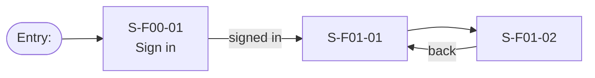
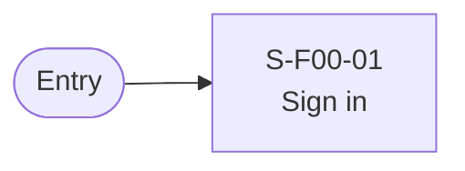

# Screen Transition Diagram: <Product name>

<!--
DBIZ2 Lesson 8 template. File: docs/external-design/screen-transition.md
Nodes are Screen IDs from docs/external-design/screen-list.md. Arrows are user actions or system events.
How many diagrams: one per actor, because each actor sees a different set of screens. Screens
shared by several actors (sign in) appear in each of their diagrams. Do NOT split by goal: the
goals of one actor share screens and the paths between goals are where dead ends hide.
- Small product (about 8 screens or fewer) where actors see almost the same screens: one diagram.
- Actor with many screens (about 15 or more): split by feature, every part starting from the
  same hub screen (Home), plus one overview with the hub and the features.
-->

## 1. <Actor 1>

Conventions:

- Node ID: the Screen ID with `-` replaced by `_` (Mermaid IDs cannot contain `-` safely at the
  start), and the label shows the real Screen ID on the first line.
- Arrow label: the user action ("taps Book"), or a system event in brackets ("[booking saved]").
- A modal is not a node. Write it on the arrow if it matters ("confirms in dialog").
- Rounded stadium nodes are entry points from outside the product (email link, QR code, push
  notification).

## 2. <Actor 2>

## Checks before you save

- [ ] Every screen in the Screen List appears in exactly one or more of the diagrams.
- [ ] Every screen is reachable from an entry point.
- [ ] No dead end: every screen has a way out (back, home, or a next step).
- [ ] The main task of each actor reaches its result in three screens or fewer from the start
      screen, or the team has written down why not.
- [ ] Every arrow label is a user action or a system event, never a screen name.
- [ ] Usage-flow paths: for every arrow "UC-a to UC-b" in usage-flow.md there is a path from a
      screen of UC-a to a screen of UC-b, or UC-b starts from an entry point (email link, QR
      code) because the actor leaves the product in between. Fill the table below.
- [ ] The diagram renders on mermaid.live.

## Usage-flow paths

| Usage-flow arrow | Path on this diagram |
|---|---|
| UC-.. to UC-.. | S-F..-.. → S-F..-.. (action), or entry point "<...>" |
