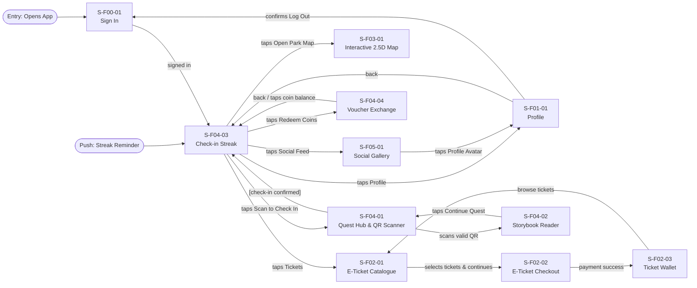
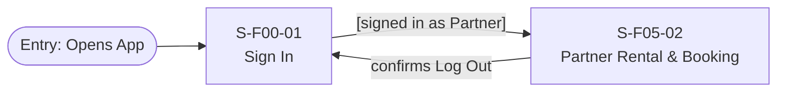
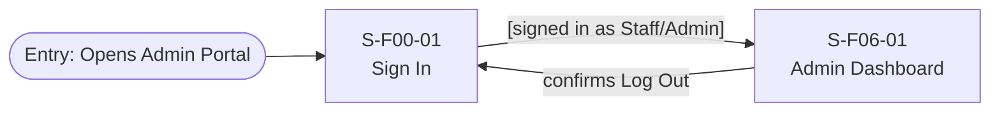

Dưới đây là toàn bộ mã Markdown hoàn chỉnh từ đầu đến cuối cho 2 tệp dùng chung còn lại: **`screen-transition.md`** và **`ui-conventions.md`**. Bạn chỉ cần sao chép từng khối mã và lưu vào tệp tương ứng trên GitHub là xong.

---

### 1. Mã hoàn chỉnh cho tệp `screen-transition.md`

```markdown
# Screen Transition Diagram: MySen Platform

## 1. Visitor / GenZ Customer Flow



---

## 2. Partner / Commercial Flow



---

## 3. Staff & Admin Flow



> **Ghi chú chuyển trang:**
> * Trong màn hình `S-F06-01` (Admin Dashboard), Staff/Admin chuyển đổi giữa các tab (*Overview*, *Campaigns*, *Push Notifications*, *Staff & Roles*) mà không dời khỏi màn hình.
> * Trong màn hình `S-F00-01`, người dùng chuyển giữa 5 panel (*Sign In*, *Create Account*, *Enter Code*, *Forgot Password*, *Set New Password*) trong cùng 1 thẻ card.
> 
> 

---

## 4. Usage Flow Transition Matrix

| Transition Path | Trigger / Action | Destination Screen |
| --- | --- | --- |
| S-F00-01 → S-F04-03 / S-F06-01 | Sign in accepted (Role-based) | S-F04-03 (Visitor) / S-F06-01 (Staff) |
| S-F04-03 → S-F02-01 | Taps Tickets tab | S-F02-01 (E-Ticket Catalogue) |
| S-F02-01 → S-F02-02 | Selects ticket quantity & taps Continue | S-F02-02 (E-Ticket Checkout) |
| S-F02-02 → S-F02-03 | Payment verified by Webhook | S-F02-03 (Ticket Wallet) |
| S-F04-03 → S-F04-01 | Taps "Scan to Check In" | S-F04-01 (Quest Hub & QR Scanner) |
| S-F04-01 → S-F04-02 | Scans valid checkpoint QR | S-F04-02 (Storybook Reader) |
| S-F04-03 → S-F04-04 | Taps "Redeem Coins" | S-F04-04 (Voucher Exchange) |
| S-F04-03 → S-F03-01 | Taps "Open Park Map" | S-F03-01 (Interactive 2.5D Map) |
| S-F04-03 → S-F05-01 | Taps Social Gallery tab | S-F05-01 (Social Feed) |
| S-F00-01 → S-F05-02 | Sign in as Partner | S-F05-02 (Partner Rental & Booking) |

```

---

### 2. Mã hoàn chỉnh cho tệp `ui-conventions.md`

```markdown
# UI Conventions: MySen Platform

## 1. Language & Tone

- **Interface Language:** English (Default for Release 1).
- **User Address:** Direct and friendly "you" / "your".
- **Button Labels:** Verb-first action descriptions in Title Case (e.g., "Submit Order", "Confirm Payment", "Redeem Reward", "Save Changes", "Get Directions", "Post a Photo"). Never use isolated generic words like "OK" or "Submit".

---

## 2. Standard Formats

| Item | Format | Example | Notes |
|---|---|---|---|
| Date | `DD/MM/YYYY` | 16/10/2026 | Standard date format |
| Time | `HH:mm` (24-hour) | 14:30 | 24-hour clock |
| Date and Time | `DD/MM/YYYY HH:mm` | 16/10/2026 14:30 | Timestamp format |
| Currency | `#,### VND` | 120,000 VND | Thousands separator is comma |
| Coin / Points | `#,### coins` | 1,250 coins | Platform loyalty currency |
| Numbers | Thousands separator is comma | 1,200 visitors | Standard numeric display |
| Phone Number | `0xxx xxx xxx` | 0912 345 678 | 10 digits starting with 0 |
| Personal Names | Full name field, Vietnamese diacritics supported | Nguyễn Hải Long | Displayed as typed |

---

## 3. Standard Component Rules

| Component | When to Use | Usage Rules & Notes |
|---|---|---|
| **Primary Button** | Main call-to-action per screen/panel | Maximum 1 per screen/tab; filled with primary brand color; disabled state clearly shaded. |
| **Secondary Button** | Alternative or supporting actions | Outlined or text style (e.g., "Cancel", "Share Achievement", "Try Again"). |
| **Text Input** | Data entry fields | Field label on top, inline validation error text displayed below field. |
| **Modal / Dialog** | Confirm or cancel critical single actions | Used for critical confirmations (e.g., "Log Out", "Confirm Redemption"); never used for main page navigation. |
| **Bottom Sheet** | Display contextual details or complex inputs | Slides up from bottom (e.g., Voucher Code display `M-F04-04`, Attraction Details `M-F03-01`, Create Post `M-F05-01`). |
| **Toast Notification** | Non-blocking brief feedback | Auto-dismisses after 3 seconds (e.g., "Profile saved.", "Report sent."). |
| **Banner** | Persistent situational information | Includes icon + text (e.g., Lock-out countdown, Offline alert, Streak ended alert). |
| **Segment Control / Tabs** | Switch sections within the same screen | Uses noun labels; active tab indicated by font weight and underline indicator, not color alone. |
| **Badge / Status Chip** | Display state or counter | Always includes text label + icon (e.g., "Open", "Closed", "Active", "Redeemed", "Booked"). |
| **Map Marker** | Point of interest on 2.5D map | Accessible text alternative provided for screen readers. |

---

## 4. Message & Feedback Patterns

| Situation | Design Pattern | Standard Example |
|---|---|---|
| **Validation Error** | Explicit explanation + how to fix | *"Enter a valid phone number or email address."* |
| **System / Network Error** | Actionable cause + recovery button | *"We couldn't load your profile. Check your connection and try again."* |
| **Empty State** | Clear reason + primary call-to-action | *"The gallery is empty. Be the first to share a photo!"* |
| **Success Confirmation** | Brief positive confirmation | *"Voucher redeemed! You can find it in My Vouchers."* |
| **Permission Denied** | Explanation + fallback guidance | *"Camera access is required to scan QR codes. You can also enter the code manually."* |

---

## 5. Accessibility & Responsive Guidelines (WCAG 2.2)

- **Mobile Baseline:** Minimum target width 360px. Single-column responsive layout.
- **Touch Target Size:** Minimum 24x24 CSS px (recommended 48x48 dp on mobile touchscreens).
- **Color Contrast:** Minimum 4.5:1 contrast ratio for body text against background.
- **Color Independence:** Status and state information must never be conveyed by color alone (always pair color with icons, text badges, or labels).
- **Screen Reader Support:** All images/icons provide alt text; interactive components use proper ARIA labels and focus trap inside modals.

```
