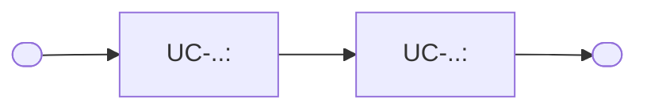
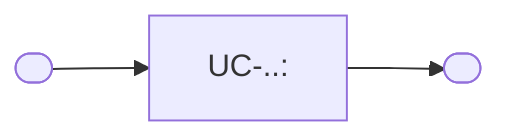

# Usage Flow: <Product name>

<!--
DBIZ2 Lesson 8 template. File: docs/external-design/usage-flow.md
One map per actor and goal: the order in which an actor uses the system's use cases in real life
to reach one goal. An actor with one goal gets one flow; an actor who comes for clearly different
goals gets one flow per goal.
It is the bridge between Lesson 7 (one activity diagram = one use case) and the screens
(one actor moves through several use cases). Do not copy objectives, features or the architecture
here: they already live in W0, the Function List and your Lesson 4 architecture.
-->

| Field | Value |
|---|---|
| Product | |
| Version | v0.1 |
| Date | |
| Sources | W0 Table 1 (use case inventory); Use Case Diagram; `docs/activity/activity-index.md` |

## Before you draw: is Lesson 4 still true?

<!-- Open the Inputs check table at the top of docs/activity/activity-index.md (Lesson 7).
     Every finding must be closed in its source: Use Case Diagram, Context Diagram, sequence
     diagrams or the Lesson 4 architecture (a change to the architecture gets an ADR).
     Fix the source; do not restate it here. -->

- [ ] Every row of the Inputs check table has Status "Done", or is logged as an open question.

## <Actor 1>: <goal>

<!-- How many flows: at least one per actor that starts a use case. Split an actor into one flow
     per goal when the actor comes for clearly different reasons, or when one flow would need
     more than about 9 boxes. Use cases started by time or by an external system get no flow.
     Boxes are use cases, not clicks. Start from the situation that makes the actor come
     (rounded node), end at the goal reached. A diamond is allowed when the actor chooses
     between use cases. Every label in double quotes; no node named end. -->

| Step | Use case | Activity diagram | Screens (fill in after Block 2) |
|---|---|---|---|
| 1 | UC-.. <name> | `AD-UC-...md` or "not needed" | S-F..-.. |
| 2 | | | |

## <Actor 2>: <goal>

| Step | Use case | Activity diagram | Screens (fill in after Block 2) |
|---|---|---|---|
| 1 | | | |

## Use cases without a flow

<!-- One line per use case started by time or by an external system: name, trigger, and where it
     is described instead (its activity diagram). -->

| Use case | Started by | Described in |
|---|---|---|
| UC-.. <name> | Time / <external system> | `AD-UC-...md` |

## Checks before you save

- [ ] Every actor that starts a use case has at least one flow.
- [ ] An actor with clearly different goals has one flow per goal; no flow has more than about
      9 boxes.
- [ ] Every actor name matches the Use Case Diagram and the Context Diagram.
- [ ] Coverage: every in-scope use case of W0 Table 1 (Must, Should, Could) that a person starts
      appears in at least one flow, with the same ID and name. A use case may appear in several
      flows. Use cases started by time or an external system are listed under "Use cases without
      a flow". Won't-have use cases appear nowhere.
- [ ] No box is a click or a screen; no box tells two use cases.
- [ ] Every flow renders on mermaid.live.
- [ ] After Block 2: every step has at least one screen, and every screen in the screen list
      appears in some step.

---
Template source: DBIZ2, VJCBI College - FTU, Lesson 8 (2026).
